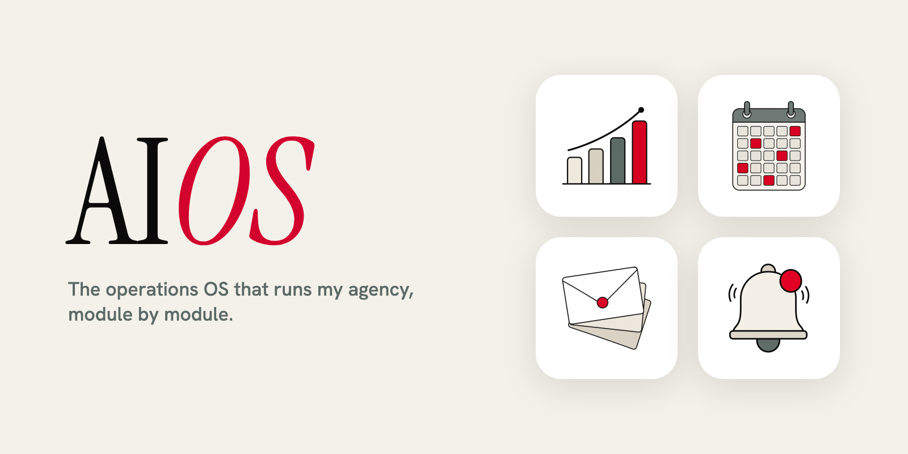

# AIOS: The Operations OS

> Follow [@davis.mcm](https://instagram.com/davis.mcm) and [@os.operator](https://instagram.com/os.operator) on Instagram for more guides like this.

### Every email, lead, and note in the business on one screen, with an agent that answers from your own files.

This is the build kit for the dashboard from the video. It goes module by module: what each piece does, how it works underneath, the files to copy, and a prompt you paste into Claude Code to build it. It is not a template app you clone. You build your own, in your stack, in about a weekend per module.

**What you'll get:**

→ The architecture: one dashboard, one worker, one Postgres database, one markdown vault, and why they never talk to each other directly
→ The inbox module: Gmail API over OAuth with no MCP in the middle, two-minute delta sync, and a Haiku triage classifier with the full prompt and tool schema
→ The correction loop: leave a note on a wrong label and the system re-learns, then the nightly dream agent folds the day into your vault
→ Operator: a working Agent SDK script that answers from your vault and cites the pages it used
→ Atlas: a leads map with zero geocoding API calls, plus the script that builds the city lookup table
→ A copy-paste build prompt for every module, the database schema, an env template, and a tested OAuth script

> [!IMPORTANT]
> **Prerequisites:**
> 1. [Claude Code](https://docs.claude.com/en/docs/claude-code/overview) installed, plus an Anthropic API key for the agents
> 2. Node 20 or newer
> 3. A free [Supabase](https://supabase.com) project (any Postgres works)
> 4. A Google Cloud project for the Gmail API (free)
> 5. An Obsidian vault, or any folder of markdown files. If you have neither, start with the [Agent Vault Starter](../agent-vault-starter/)

---

## Table of Contents

1. [The shape](#1-the-shape)
2. [Build order](#2-build-order)
3. [Foundation: database and env](#3-foundation-database-and-env)
4. [Inbox: Gmail sync and triage](#4-inbox-gmail-sync-and-triage)
5. [The correction loop](#5-the-correction-loop)
6. [Vault: the memory layer](#6-vault-the-memory-layer)
7. [The dream agent](#7-the-dream-agent)
8. [Operator: chat that reads your files](#8-operator-chat-that-reads-your-files)
9. [Atlas: the leads map](#9-atlas-the-leads-map)
10. [Mission Control](#10-mission-control)
11. [Propose, then approve](#11-propose-then-approve)
12. [Which model does which job](#12-which-model-does-which-job)
13. [Pro tips](#13-pro-tips)
14. [Limitations](#14-limitations)
15. [Quick reference](#15-quick-reference)
16. [Sources](#16-sources)

---

## 1. The shape

Most "AI dashboards" are a rendered page with numbers that move. This one is three processes and a database, and every number on it comes from a row you can query.

```plain text
      YOUR LAPTOP                                    ALWAYS ON
+---------------------------+                +------------------------+
|  Dashboard (Next.js)      |                |  Worker (Node)         |
|  127.0.0.1:3100 only      |                |                        |
|                           |                |  - Gmail delta sync    |
|  - Mission Control        |                |  - triage (Haiku)      |
|  - Operator chat (Opus)   |                |  - daily brief (Sonnet)|
|  - dream agent (Opus)     |                |  - actions queue       |
|  - reads the vault        |                |  - cron jobs           |
+-------------+-------------+                +-----------+------------+
              |                                          |
              v                                          v
      +--------------------------------------------------------+
      |                 Postgres (Supabase)                     |
      |  emails / triage / actions / briefs / leads / events    |
      +--------------------------------------------------------+
              ^
              |  read, plus guarded writes
+-------------+-------------+
|  Vault (markdown folder)  |
|  opened in Obsidian       |
+---------------------------+
```

The rule that makes it simple: **the dashboard and the worker never talk to each other.** They both read and write the same database. If the dashboard wants an email archived, it inserts a row into an `actions` table. The worker picks it up, does it, and writes the result back. No tunnel, no open port, no auth between services, and a free audit trail of everything the system did.

The worker can run on a small server or on the same laptop. It only needs to be on when you want mail syncing.

> [!NOTE]
> The deep version of this architecture (cron cadences, resilience, deployment, security posture) lives in the [AI OS section](../../ai-os/). This guide is the build path.

---

## 2. Build order

Build in this order. Each module works on its own and makes the next one better.

1. **Foundation.** Database, schema, env. One hour.
2. **Inbox.** Gmail sync, then triage. This is the module that pays for itself first.
3. **Vault.** Point the dashboard at your markdown folder.
4. **Operator.** Chat over the vault. Read only.
5. **Dream agent.** Nightly consolidation, so the vault keeps itself current.
6. **Atlas and Mission Control.** The views on top.

Skip anything you do not need. If you have no lead list, skip Atlas. If you do not live in email, start with the vault and Operator.

---

## 3. Foundation: database and env

Create a Supabase project, open the SQL editor, and run [templates/schema.sql](templates/schema.sql). It creates the core tables:

- **accounts, email_threads, emails:** one row per mailbox, thread, and message
- **email_triage:** the label, priority, summary, and your note for every email
- **actions:** the queue between dashboard and worker
- **daily_briefs, notifications, events:** what Mission Control shows
- **conversations, messages, agent_runs:** Operator's chat history and the cost of every agent run
- **leads, city_centroids:** what Atlas maps
- **sync_state, heartbeats:** settings, cursors, and "is the worker alive"

Copy [templates/env.example](templates/env.example) to `.env` in your project and fill it in as you go. Supabase gives you two connection strings. Use the pooled one for the dashboard and the direct one for the worker.

**Build prompt:**

```markdown
Scaffold a pnpm monorepo for my operations dashboard:
- apps/dashboard: Next.js (App Router, TypeScript, Tailwind, shadcn/ui). Dev server bound to 127.0.0.1 on port 3100 only.
- apps/worker: plain Node + TypeScript with node-cron, no framework.
- packages/db: Drizzle ORM schema that matches ./schema.sql exactly, with drizzle-kit for migrations.
Read DATABASE_URL (pooled) in the dashboard and DATABASE_URL_DIRECT in the worker and migrations.
The dashboard and worker must never call each other. They only share the database.
Add a heartbeat cron in the worker that upserts sync_state key "worker_heartbeat" every minute.
```

---

## 4. Inbox: Gmail sync and triage

<p align="center"></p>

Three inboxes, one feed, every email labeled before I see it.

### Auth: Gmail API over OAuth, no MCP in the middle

The worker calls the Gmail API directly with the official `googleapis` library. There is no MCP server between the agent and the inbox at runtime, which is why it is fast and why it does not drop connections.

Setup, once:

1. In [Google Cloud Console](https://console.cloud.google.com), create a project and enable the **Gmail API**.
2. Under **Google Auth Platform**, configure the consent screen and add yourself as a test user.
3. Create an OAuth client of type **Desktop app**. Copy the client ID and secret into `.env`.
4. Run the token script once per mailbox, signed into that mailbox in your browser:

```bash
cd scripts
npm install google-auth-library
GMAIL_CLIENT_ID=your-id GMAIL_CLIENT_SECRET=your-secret node gmail-refresh-token.mjs
```

It prints a refresh token. Paste it into `.env` as `GMAIL_PRIMARY_REFRESH_TOKEN` (rename per mailbox). The `googleapis` client trades it for access tokens and refreshes them on its own. Tokens never touch the database.

The script asks for `gmail.modify`: read, label, archive, trash, and create drafts. It cannot permanently delete mail.

### Sync: two-minute delta, not a full re-read

- **First run:** backfill the last 30 days with `messages.list` and the query `newer_than:30d -in:chats`, then store the mailbox's newest `historyId`.
- **Every 2 minutes:** call `history.list` from that stored cursor. Gmail returns only what changed. Fetch those messages, upsert them, move the cursor.
- **If the cursor goes stale:** Gmail returns 404. Retry quietly. After 5 failures in a row, re-backfill and reseed.
- **Rate limits:** on 429 wait 5 seconds plus jitter, on 403 wait 60, retry up to 4 times.

Row IDs are `<accountKey>:<gmailId>`, so three inboxes live in one table without collisions.

### Triage: Haiku with a forced tool call

Every new email goes through a classifier on `claude-haiku-4-5`. It cannot reply in prose. It has to fill in a `record_triage` tool call with a category, a priority from 1 to 5, a confidence, and a one-sentence summary.

Seven categories: `action_needed`, `reply_needed`, `client`, `fyi`, `infra`, `newsletter`, `spamish`. The full prompt, category definitions, priority scale, and tool schema are in [templates/triage-prompt.md](templates/triage-prompt.md).

Two details do most of the work:

1. **The known-contacts roster.** The system prompt lists every person and company from the vault. A sender who matches is real by definition. That one block is the difference between a classifier that flags your best client as spam and one that does not.
2. **The label goes back to Gmail.** Each thread gets `AIOS/<Category>`, so Gmail on your phone shows the same triage the dashboard does.

**Build prompt:**

```markdown
Build the Gmail module in apps/worker.
1. gmail/client.ts: one googleapis OAuth2 client per mailbox from GMAIL_CLIENT_ID, GMAIL_CLIENT_SECRET, and GMAIL_<KEY>_REFRESH_TOKEN. Cache clients per account.
2. gmail/backfill.ts: when accounts.last_history_id is null, list messages with q "newer_than:30d -in:chats", fetch each with format full (concurrency 5), parse to plain text, upsert email_threads and emails with ids "<accountKey>:<gmailId>", then store the newest historyId.
3. gmail/incremental.ts: every 2 minutes, history.list from the cursor with historyTypes messageAdded, keep INBOX only, skip SENT, DRAFT, CHAT. On 5 consecutive 404s, re-backfill.
4. triage/classify.ts: every 2 minutes, take 10 emails with no email_triage row, newest first. Call claude-haiku-4-5 with the system prompt and record_triage tool from ./triage-prompt.md, forced tool choice, system block cached. Validate with zod, insert email_triage, and apply the Gmail label AIOS/<Category> to the thread.
5. Build the known-contacts roster from the people and company pages in VAULT_PATH.
Use node-cron. Wrap each loop so 3 failures in a row pause it and write one notifications row.
```

---

## 5. The correction loop

<p align="center"></p>

The classifier is not always right. That is fine, as long as fixing it takes five seconds and sticks.

The example from the video: a Google Ads offer for $4,000 in ad credit. Triage called it spam. Fair, it reads like marketing. But it is from Google and I might use it. So I leave a note on the email: *might use this for ad spend, remind me to claim it.*

What the note does:

1. **Saves to the email.** It lands in `email_triage.user_note`.
2. **Queues a re-triage.** The dashboard inserts an `actions` row with kind `retriage`. The worker runs the classifier again with the note appended to the prompt, under a line that says to weigh it heavily. The email gets a new category, and the Gmail label moves with it.
3. **Reaches the vault overnight.** The dream agent reads every email from the day with its current triage, so the corrected label and summary get folded into the vault that night.

For corrections that apply to every email ("anything from this domain is a client"), there is a second note: a standing triage note stored in `sync_state`. The classifier appends it to every system prompt and follows it over the defaults.

The AI does the organizing. I add the opinions.

**Build prompt:**

```markdown
Add the correction loop to the inbox.
1. In the thread reader, add a note field. PUT /api/triage/note saves email_triage.user_note.
2. Add a Re-triage button. POST /api/triage/retriage saves the note and inserts actions { kind: "retriage", payload: { emailId, note }, status: "pending" }.
3. In the worker actions loop, handle retriage: re-run the classifier with the note appended to the user message as "[MY NAME]'s note on this specific email (weigh it heavily, it is a correction or context):", update email_triage with the new category in corrected_category, and move the Gmail label.
4. Add a "Triage notes" dialog that edits sync_state key "triage_notes". Append its text to every triage system prompt as standing guidance that overrides the defaults.
```

---

## 6. Vault: the memory layer

<p align="center"></p>

The vault is a folder of markdown files. Obsidian opens it, the dashboard reads it, and agents write to it through guarded tools. There is no sync service and no plugin. One folder on disk, three readers.

- **Objective layer:** people, companies, clients, deals, decisions, concepts. Facts about the business.
- **Three root files:** `hot.md` (a roughly 500-word note of what is happening right now), `index.md` (one line per page), and `log.md` (append-only history of every write).
- **Raw sources:** `sources/YYYY/` holds transcripts and emails as they came in. Nothing ever edits them.

The dashboard builds an in-memory index of the folder on start (frontmatter, titles, `[[wikilinks]]`) and keeps it current with a file watcher. It also copies people and companies into Postgres so the worker, which may not be on the same machine, can use them for the triage roster.

<p align="center"></p>

Mine sits at 355 notes. Almost none of them were typed by hand.

> [!TIP]
> Do not design the vault from scratch. The [Agent Vault Starter](../agent-vault-starter/) ships the whole thing: the contract, the frontmatter schema, ten page templates, the ingest, query, lint, and dream skills, and a validator. Run its one command, then point `VAULT_PATH` at the folder.

**Build prompt:**

```markdown
Add the vault to the dashboard.
1. lib/vault: walk VAULT_PATH (ignore .obsidian, .git, .claude), parse frontmatter with gray-matter, extract [[wikilinks]], keep an in-memory index keyed by path, basename, alias, and title. Keep it current with a chokidar watcher, 300 ms debounce.
2. API routes: GET /api/vault/tree, /api/vault/note?path=, /api/vault/search?q=.
3. A Vault panel: file tree on the left, rendered markdown on the right, wikilinks clickable.
4. On build and on every change, upsert people and company pages into a vault_entities table so the worker can read them. Never wipe the table on an empty read.
The vault is read only from the dashboard. Writes only happen through the dream agent's tools.
```

---

## 7. The dream agent

<p align="center"></p>

Every night at 3am, an agent runs one pass over the day and folds it into the vault. It runs 24/7 in the sense that matters: you never have to remember to update anything.

What it reads:

- Every email since its last run, with the current triage (including your corrections)
- Every message you sent Operator in the last 24 hours, which it treats as the highest-priority signal
- The daily brief and every vault page that changed today

What it does, in four phases: **orient** (read `hot.md` and `index.md`), **gather** (pull the signal), **consolidate** (update existing pages, create pages for genuinely new people and deals, resolve contradictions), and **prune** (rewrite `hot.md`, refresh `index.md`).

The guardrails are in code, not in the prompt:

- The write tool refuses anything under `sources/`, validates frontmatter against the schema, and logs every write to `log.md`.
- Bash, Write, Edit, and web tools are disabled. It can only use its eight vault tools.
- A 30-minute lock, a one-hour minimum gap between runs, and it skips the run entirely on a day with no activity.

It runs on the Claude Agent SDK with `claude-opus-4-8` and a 50-turn cap, scheduled by macOS launchd so it runs on the machine that has the vault.

The full system prompt and the launchd job ship in the vault starter: [dream-agent-prompt.md](../agent-vault-starter/templates/dream-agent-prompt.md) and [com.vault.dream.plist](../agent-vault-starter/templates/com.vault.dream.plist).

**Build prompt:**

```markdown
Build the nightly dream agent as scripts/dream.ts in the dashboard.
Use the Claude Agent SDK query() with model claude-opus-4-8, maxTurns 50, settingSources [], cwd = VAULT_PATH, and the system prompt from dream-agent-prompt.md.
Give it one in-process MCP server "dream" with these tools and nothing else:
vault_search, vault_read, vault_list, recent_emails (emails since the last run joined to email_triage, including user_note), recent_activity (last 24h of chat messages and agent runs), vault_write_note (refuses sources/, validates frontmatter with zod, sets updated to today, appends to log.md), vault_append_log, vault_update_index.
Disallow Bash, Write, Edit, WebFetch, WebSearch.
Gate the run: skip if sync_state.dream_lock is under 30 minutes old, if the last run was under an hour ago, or if there was no activity. Release the lock in finally. Record an agent_runs row with tokens and cost, and write a notification.
Add a launchd plist that runs it at 03:00 local, and a "Dream now" button on the Agents page.
```

---

## 8. Operator: chat that reads your files

<p align="center"></p>

I ask it to list out all my offers. Does it guess? No.

<p align="center"></p>

It loads its vault tools, searches for "offers", reads the pages, and answers from my own files, with a link to every page it used.

That behavior comes from three things:

1. **Retrieval order in the system prompt.** Read `hot.md` first, then `index.md`, then the specific pages. Search only when the page name is unknown. "Do not answer from memory when the vault has the answer."
2. **Citations as wikilinks.** Every page it used comes back as `[[page-name]]`, and the dashboard turns those into clickable links into the vault.
3. **No write tools.** The vault is read only to Operator. For email it gets `propose_*` tools that queue an action for approval (section 11). Write, Edit, and Bash are disabled.

It runs on the [Claude Agent SDK](https://docs.claude.com/en/docs/agent-sdk/overview) with in-process MCP tools. When you register MCP tools, the SDK can defer loading them and pull them in with its ToolSearch tool on demand. That is the "loads its tools" step you see in the video.

### Run it in two minutes

[templates/operator.mts](templates/operator.mts) is a working, read-only Operator in one file: three vault tools, the retrieval prompt, and the citation rule.

```bash
npm install @anthropic-ai/claude-agent-sdk zod tsx
VAULT_PATH=~/path/to/your/vault ANTHROPIC_API_KEY=sk-ant-... npx tsx operator.mts "list out all my offers"
```

It prints every tool call it makes, then the answer. Point it at your real vault and ask it what is going on with your biggest client.

**Build prompt (the dashboard version):**

```markdown
Turn templates/operator.mts into the dashboard chat.
1. POST /api/chat streams Server-Sent Events from the Agent SDK query(): text deltas and tool calls. maxDuration 300.
2. Persist conversations and messages. Store the SDK session id on the conversation and pass it as resume for follow-ups.
3. Render [[wikilinks]] in answers as links that open the page in the Vault panel.
4. Show tool calls inline as collapsible rows so I can see what it searched and read.
5. Write an agent_runs row per turn with tokens and cost.
Keep the vault read only. Disallow Write, Edit, and Bash.
```

---

## 9. Atlas: the leads map

<p align="center"></p>

Every lead in the database on a map. Zoom in on a cluster until it breaks into single dots, click one, and the business card pops up.

- **Map:** [MapLibre GL](https://maplibre.org) 5 with free [OpenFreeMap](https://openfreemap.org) tiles. No Mapbox account, no per-load billing.
- **Clustering:** a GeoJSON source with `cluster: true` and `clusterRadius: 50`. Thirty thousand points stay smooth because MapLibre does the clustering in a web worker.
- **Popup:** business name, a status dot, and city, state, segment, status. The full record lives on the Leads page.

### Geocoding with zero API calls

Geocoding 30,000 addresses through an API costs money and hits rate limits. Atlas does not need street precision. It needs the city.

So the map uses the US Census Gazetteer places file, which is public domain and lists a center point for every city and town in the country. Load it once into a `city_centroids` table, and geocoding becomes one SQL statement that runs every hour.

```bash
curl -LO https://www2.census.gov/geo/docs/maps-data/data/gazetteer/2024_Gazetteer/2024_Gaz_place_national.zip
unzip 2024_Gaz_place_national.zip
python3 scripts/gazetteer-to-csv.py 2024_Gaz_place_national.txt > city_centroids.csv
psql "$DATABASE_URL_DIRECT" -c "\copy city_centroids FROM 'city_centroids.csv' CSV HEADER"
```

That produces about 32,000 places. Then geocode every lead that has a city and state:

```sql
UPDATE leads l
SET lat = c.lat, lng = c.lng
FROM city_centroids c
WHERE l.lat IS NULL
  AND c.state = upper(l.state)
  AND c.city = regexp_replace(regexp_replace(regexp_replace(
        regexp_replace(lower(trim(l.city)), '[.''’]', '', 'g'),
        '^st ', 'saint '), '^ft ', 'fort '), '^mt ', 'mount ');
```

The script normalizes the Census names: lowercase, punctuation stripped, "city" and "town" suffixes removed, "St" expanded to "Saint". The `WHERE` clause applies the same steps to your lead cities, so "St. Petersburg" in a lead matches "saint petersburg" in the table. Store states as two-letter codes.

**Build prompt:**

```markdown
Build the Atlas page.
1. GET /api/atlas returns leads with non-null lat as GeoJSON points with properties id, business, status, city, state, segment only.
2. Render with maplibre-gl and the OpenFreeMap positron style (dark style in dark mode). GeoJSON source with cluster true, clusterRadius 50, clusterMaxZoom 14. Three cluster sizes by count, with the count as the label.
3. Clicking an unclustered point opens a popup card: business name, a status color dot, and "City, ST / segment / status".
4. Add a worker cron, hourly, that runs the city_centroids geocode UPDATE.
```

---

## 10. Mission Control

The home page. My objective snapshot: the metrics, the schedule, mail volume, and notifications for everything going on.

- **Stat cards:** unread, needs action, leads, content signals. One grouped query each, all fired in parallel, with a 20-second timeout so a slow query cannot hang the page. It refetches every 60 seconds.
- **Mail volume:** 90 days of email per mailbox as a stacked area chart (recharts), zero-filled so quiet days show as quiet.
- **Schedule:** a month calendar over the `events` table.
- **Notifications:** the last 10 unread, from triage, the brief, the dream agent, and worker alerts.
- **Daily brief:** written by the worker at 7am.

### The daily brief

One Messages API call to `claude-sonnet-4-6`, no tools. The worker gathers:

- action and reply emails from the last 7 days (top 40 by priority)
- proposed actions waiting on approval
- worker alerts and how long ago each mailbox synced
- active leads and deals

It formats those as text and asks for at most three sections (Act on, Systems only if something is broken, Pipeline), each bullet a bold two-to-four-word headline plus one sentence. On a quiet day the whole brief is one line: "Quiet day, nothing needs you and systems are healthy."

**Build prompt:**

```markdown
Build Mission Control.
1. GET /api/overview: run every count in parallel with Promise.all (unread per account, action_needed and reply_needed counts, leads, notifications, worker heartbeat age, pending proposed actions, emails per day per account for 90 days). Race it against a 20s timeout that returns 503.
2. Page: stat cards, a recharts stacked AreaChart for mail volume (zero-fill missing days), a month calendar over events, the latest daily_briefs markdown, and unread notifications. Refetch every 60s with TanStack Query.
3. Worker job daily-brief at 07:00: gather the inputs above, call claude-sonnet-4-6 once with max_tokens 1500, store the markdown in daily_briefs (unique on brief_date), and insert a notification.
4. Strip em dashes from the model output in code before saving.
```

---

## 11. Propose, then approve

Operator can archive, trash, star, mark read, and draft replies. It cannot do any of it on its own.

Every email tool it has is a `propose_*` tool. Calling one inserts an `actions` row with status `proposed` and tells the model: "Queued for approval, not executed." The row shows up in an Approvals list. Approve flips it to `pending`, deny flips it to `denied`, and both updates are guarded with `WHERE status = 'proposed'` so a double click does nothing.

The worker checks the queue every 30 seconds, claims up to 20 pending rows with `UPDATE ... WHERE status = 'pending'` (two workers can never grab the same one), runs them, and writes `done` or `failed` with the result.

Sending is not implemented in the worker at all. The furthest an agent can get is a draft in your Gmail that you send yourself.

---

## 12. Which model does which job

- **Triage:** `claude-haiku-4-5`. High volume, narrow task, forced tool output. Cheapest model, cached system prompt.
- **Daily brief:** `claude-sonnet-4-6`. Once a day, needs judgment about what matters.
- **Operator chat:** `claude-opus-4-8`. Multi-step retrieval across many pages.
- **Dream agent:** `claude-opus-4-8`. Unattended writes to your memory. Use the best model where a mistake persists.

Make the model a setting, not a constant. Mine are stored in `sync_state` and editable from the Settings page.

---

## 13. Pro tips

> [!TIP]
> **Put constraints in code, not prompts.** The brief prompt says no em dashes. The model writes them anyway. A one-line replace before saving fixes it every time.

> [!TIP]
> **Feed the roster from the vault.** The triage prompt is only as good as its list of known contacts. Generate that list from your people and company pages and triage improves every time the vault learns someone new.

> [!TIP]
> **Force tool output for classification.** `tool_choice` set to one tool means the model can only answer in your schema. Validate it with zod anyway before writing.

> [!TIP]
> **Label back into the source.** Writing `AIOS/<Category>` onto the Gmail thread means the triage works on your phone without opening the dashboard.

> [!TIP]
> **Bind the dashboard to 127.0.0.1.** Your inbox and your vault are on that page. If it never listens on a public interface, there is nothing to attack.

> [!TIP]
> **Treat your chat as the top signal.** The dream agent's prompt ranks what you said to Operator above email and above existing pages. Decisions you talk through become vault facts by morning.

---

## 14. Limitations

- **Polling, not push.** Gmail syncs every two minutes. Fine for an operations view, not for anything that needs instant reaction.
- **Google test mode.** An OAuth app in testing mode issues refresh tokens that Google can expire after 7 days. For a personal tool, publish the app (it can stay unverified for your own accounts) so tokens last.
- **City-level map.** Gazetteer geocoding puts every lead at its city center. Good for clusters and territory, not for routing.
- **The dream agent runs where the vault is.** If your laptop is asleep at 3am, that night's run waits for the next one, which consolidates both days.
- **macOS scheduling.** The launchd job is Mac only. On Linux use cron or a systemd timer with the same command.

---

## 15. Quick reference

**Files in this kit**

- [templates/schema.sql](templates/schema.sql): every table, run once
- [templates/env.example](templates/env.example): every env var by name
- [templates/triage-prompt.md](templates/triage-prompt.md): triage system prompt, categories, priority scale, tool schema
- [templates/operator.mts](templates/operator.mts): read-only Operator over your vault
- [scripts/gmail-refresh-token.mjs](scripts/gmail-refresh-token.mjs): mint a Gmail refresh token per mailbox
- [scripts/gazetteer-to-csv.py](scripts/gazetteer-to-csv.py): build the city lookup table for Atlas

**Commands**

```bash
# Gmail token, once per mailbox
GMAIL_CLIENT_ID=... GMAIL_CLIENT_SECRET=... node scripts/gmail-refresh-token.mjs

# Operator over your vault
VAULT_PATH=~/vault npx tsx templates/operator.mts "what is going on with my biggest client"

# Atlas city table
python3 scripts/gazetteer-to-csv.py 2024_Gaz_place_national.txt > city_centroids.csv
```

**Cadences**

- Gmail sync and triage: every 2 minutes
- Actions queue: every 30 seconds
- Worker heartbeat: every minute
- Geocode leads: hourly
- Daily brief: 07:00
- Dream agent: 03:00

**Stack**

- Next.js 16, TypeScript, Tailwind, shadcn/ui, TanStack Query, recharts
- Node worker with node-cron
- Postgres on Supabase, Drizzle ORM
- `googleapis` for Gmail, `@anthropic-ai/sdk` for triage and the brief, `@anthropic-ai/claude-agent-sdk` for Operator and the dream agent
- MapLibre GL with OpenFreeMap tiles
- Obsidian on the same markdown folder

---

## 16. Sources

- [Claude Agent SDK overview](https://docs.claude.com/en/docs/agent-sdk/overview)
- [Claude tool use](https://docs.claude.com/en/docs/agents-and-tools/tool-use/overview)
- [Prompt caching](https://docs.claude.com/en/docs/build-with-claude/prompt-caching)
- [Gmail API: synchronizing clients with history.list](https://developers.google.com/workspace/gmail/api/guides/sync)
- [Gmail API scopes](https://developers.google.com/workspace/gmail/api/auth/scopes)
- [OAuth 2.0 for desktop apps](https://developers.google.com/identity/protocols/oauth2/native-app)
- [MapLibre GL JS](https://maplibre.org/maplibre-gl-js/docs/)
- [OpenFreeMap](https://openfreemap.org)
- [US Census Gazetteer files](https://www.census.gov/geographies/reference-files/time-series/geo/gazetteer-files.html)
- [Supabase](https://supabase.com/docs)
- [Drizzle ORM](https://orm.drizzle.team)

---

Built by OperatorOS | [operatoros.ai](https://operatoros.ai)
Follow [@davis.mcm](https://instagram.com/davis.mcm) and [@os.operator](https://instagram.com/os.operator) on Instagram.
