# Make Reels in Claude Code

> Follow [@davis.mcm](https://instagram.com/davis.mcm) and [@operatoros](https://instagram.com/operatoros) on Instagram for more guides like this.

---

### Video editing just became a coding problem. This is the full setup, six steps, every skill and file included.

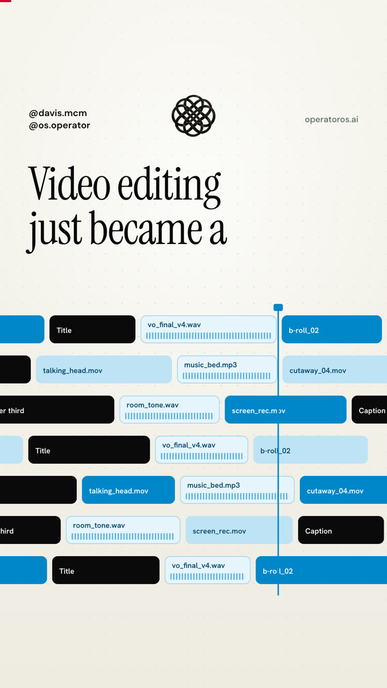

The reel that sent you here has no timeline behind it. It is one HTML file, one voice track, and one JSON file with the time every word is spoken. Claude Code wrote the file. HyperFrames rendered it to an MP4.

That changes what editing is. A timeline is a pile of clips you drag by hand. A composition in code is a file. You can read it, diff it, reuse it, and change one value to restyle every scene at once. You describe what you want in plain English and Claude edits the file.

This guide is the exact workflow, written so you can run it today: the tools, every skill, the scripts that turn a script into a voiced and timed track, a starter reel you can render in ten minutes, and the prompts I use.

---

## What you'll get

→ The six-step workflow from an empty folder to a 60 fps MP4

→ HyperFrames by HeyGen: the install, the CLI loop, and all 21 of its skills explained in one line each

→ The watch skill by Bradley Bonanno, so Claude can actually see reference videos

→ Three skills I wrote for this workflow: `reel-teardown`, `reel-script`, `reel-build`

→ `build_vo.py`: turns `script.json` into your cloned voice plus a timestamp for every word

→ `apply_timing.py`: writes those timestamps into the reel so every animation lands on its word

→ A starter reel (hook, one step, CTA) that passes `hyperframes check` and renders as is

→ A `style.md` template and the prompts to paste at each step

---

## Contents

1. [Why code beats a timeline](#1-why-code-beats-a-timeline)
2. [What you need](#2-what-you-need)
3. [Step 1: Open Claude Code](#3-step-1-open-claude-code)
4. [Step 2: Feed it references](#4-step-2-feed-it-references)
5. [Step 3: Load the skills](#5-step-3-load-the-skills)
6. [Step 4: Script, then voice](#6-step-4-script-then-voice)
7. [Step 5: Build it in code](#7-step-5-build-it-in-code)
8. [Step 6: Notes, then render](#8-step-6-notes-then-render)
9. [The prompts, in order](#9-the-prompts-in-order)
10. [Quick reference](#10-quick-reference)
11. [Sources](#11-sources)

---

## 1. Why code beats a timeline

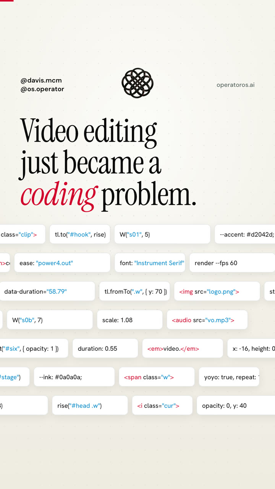

Three things are true once a video is code.

**Every visual is keyed to a word.** The voice is generated with character-level timestamps. A helper turns them into `W("s04", 3)`, the moment the fourth word of line s04 is spoken. Every animation in the reel is placed with that helper, never with a hardcoded second. Re-record the voice and the whole reel re-times itself.

**One line restyles everything.** Colors and fonts live in CSS variables. Change `--accent` and every scene, chip, and progress bar follows. In the reel, that was one prompt: "change the accent color to blue."

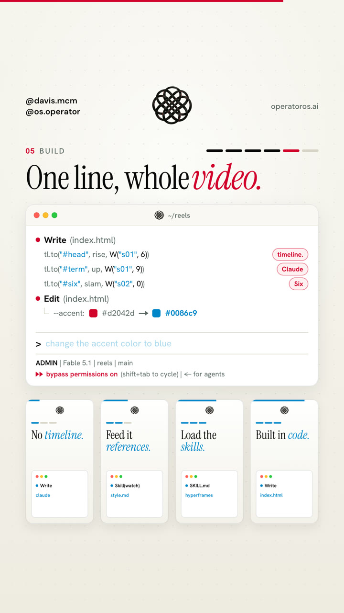

**The agent can do the editing.** Claude Code reads and writes files. A reel as a file means Claude can build it, check it, take your notes, and render it, the same way it works on any other codebase.

---

## 2. What you need

- **Claude Code.** With a Claude subscription or an API key. Install from [claude.com/claude-code](https://claude.com/claude-code).
- **Node 22 or newer and FFmpeg.** HyperFrames renders through headless Chrome, which it downloads itself. On macOS: `brew install node ffmpeg`.
- **Python 3.** For the two scripts in this guide.
- **ElevenLabs.** Instant Voice Cloning is on the Starter plan and up. On 2026-10-20 the pricing page listed Starter at $6 a month with 30k credits. A 60 second script is about 800 characters, so one full voice take costs about 800 credits.
- **Optional, a Groq or OpenAI key.** The watch skill reads captions for free when a video has them. Local files have none, so it falls back to Whisper through one of these keys. Without a key it still reads every frame.

Check the machine:

```bash
npx -y hyperframes doctor
```

It confirms Node, FFmpeg, and Chrome.

---

## 3. Step 1: Open Claude Code

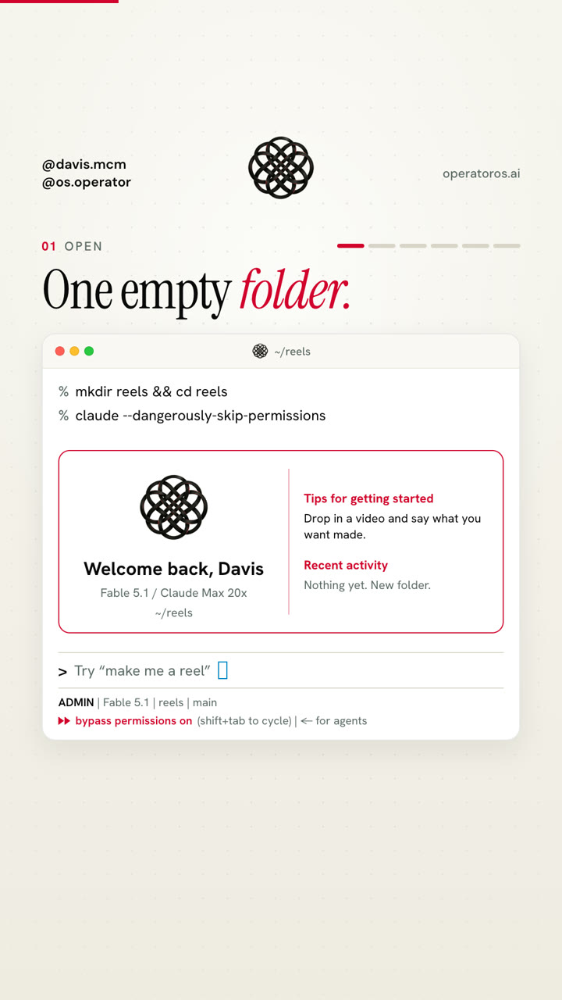

Every reel gets its own folder. That folder is the studio: the HTML, the voice, the timing, the renders, all in one place you can version.

```bash
mkdir reels && cd reels
claude
```

I run `claude --dangerously-skip-permissions` in a reel folder so it can render and snapshot without asking me before every command. It skips every approval prompt, so only use it in a folder that holds nothing but the reel.

---

## 4. Step 2: Feed it references

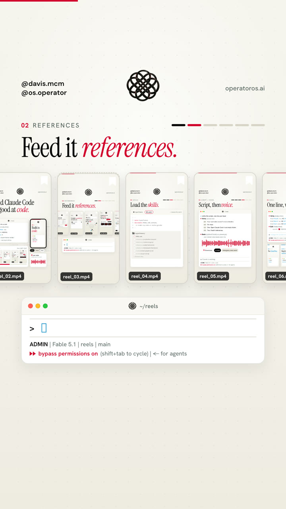

Save three to five reels you would want to have made. Same platform, same length range, ideally from creators whose edits you study anyway. Download them into the folder, or keep the links.

You do not need a scraper to start. Drop the files in and ask Claude to tear them apart.

### Install the watch skill

Claude can read a page and run a script, but it cannot watch a video on its own. The watch skill by Bradley Bonanno ([bradautomates/claude-video](https://github.com/bradautomates/claude-video), MIT) downloads the video, pulls frames at a rate scaled to its length, gets a timestamped transcript, and has Claude read every frame as an image.

In Claude Code:

```
/plugin marketplace add bradautomates/claude-video
/plugin install watch@claude-video
```

`yt-dlp` and `ffmpeg` install on first run on macOS. Then:

```
/watch reel_01.mp4 what makes the hook work?
```

### Write the style down

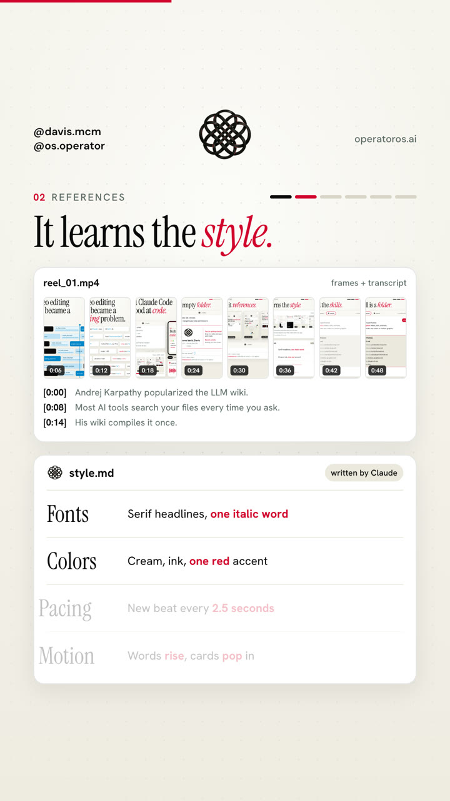

The `reel-teardown` skill in this folder runs watch on every reference, measures what is on screen, and writes `style.md`: structure, pacing, typography, color, motion, the one device that carries the reel, the CTA mechanic, and a borrow and avoid list. Every later build reads it. The template is at [`templates/style.md`](templates/style.md).

Measure, do not guess. "New beat every 2.5 seconds" is something Claude can build to. "Fast paced" is not.

Borrow the structure, the pacing, and the kind of device. Never their words, their layouts, or their assets. The reel you make has to be yours.

---

## 5. Step 3: Load the skills

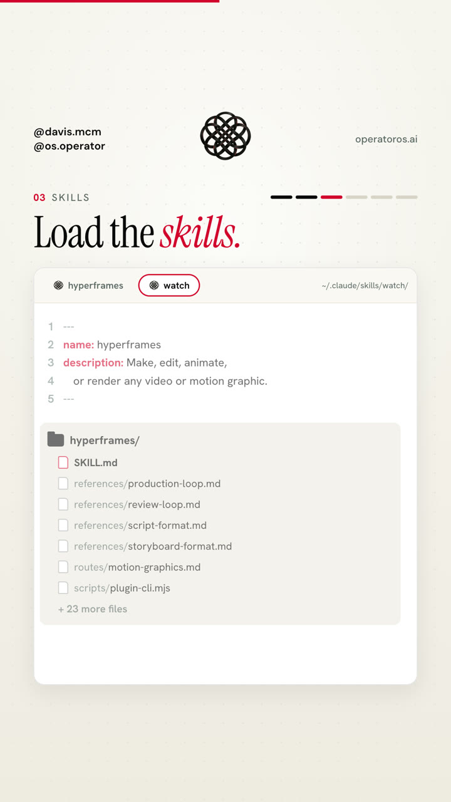

### Install HyperFrames

[HyperFrames](https://github.com/heygen-com/hyperframes) is HeyGen's open source video engine, Apache-2.0. A video is an HTML file with timed `<section class="clip">` scenes and a GSAP timeline. It renders deterministically in headless Chrome, so the same file gives the same frames every time.

```bash
claude plugin marketplace add heygen-com/hyperframes
claude plugin install hyperframes@hyperframes
```

Run the CLI through `npx`, and pin a version once a project works (`npx -y hyperframes@0.8.149 render`) so a new release never changes a render mid-project.

### A skill is a folder

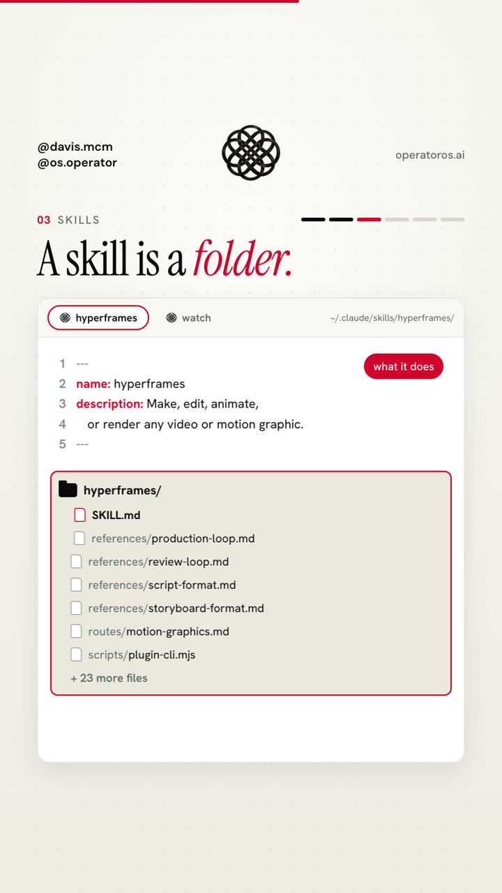

Every skill is a folder with a `SKILL.md` at the top. The frontmatter says what it does and when to use it. Claude reads that much for every skill it has, and loads the rest only when the task matches. The other files teach it how: references, scripts, commands.

```
reel-build/
  SKILL.md        <- name + description in the frontmatter, then the instructions
```

```
hyperframes/
  SKILL.md
  references/production-loop.md
  references/review-loop.md
  references/script-format.md
  references/storyboard-format.md
  references/routes/motion-graphics.md
  scripts/plugin-cli.mjs
  ...
```

### Every skill in this workflow

**HyperFrames: the entry point**

- **hyperframes:** Read first for any video request. Picks the right workflow below and loads the domain skills it needs.

**HyperFrames: workflows (pick one per video)**

- **general-video:** Any custom composition that does not fit a named workflow. This is the one the reels in this guide use.
- **faceless-explainer:** Text, notes, or a topic in, a narrated explainer out, with visuals invented per scene.
- **motion-graphics:** Short, design-led pieces where the motion is the message: kinetic type, count-ups, charts, logo stings, lower thirds.
- **product-launch-video:** A product URL, script, or brief into a launch or promo video.
- **pr-to-video:** A GitHub pull request into a code-change explainer.
- **talking-head-recut:** An existing talking-head video with designed overlays synced to the transcript, footage untouched.
- **embedded-captions:** Captions on a talking-head video, from plain subtitles to captions set behind the subject.
- **music-to-video:** A track in, a beat-synced lyric video, slideshow, or kinetic promo out.
- **slideshow:** A navigable deck with fragments, branching, and presenter mode.
- **remotion-to-hyperframes:** Ports an existing Remotion project to HyperFrames HTML.
- **figma:** Pulls Figma frames, tokens, and components into a composition.

**HyperFrames: domain skills (loaded by the workflows)**

- **hyperframes-core:** The composition contract: clips, tracks, `data-*` timing, sub-compositions, media.
- **hyperframes-animation:** Motion rules, scene blueprints, transitions, and the runtime adapters (GSAP by default).
- **hyperframes-keyframes:** Punch-ins, zooms, camera moves, and other seek-safe keyframes.
- **hyperframes-creative:** Design direction: palettes, typography, narration, beat planning.
- **hyperframes-audio:** Mixing what is already placed: fades, ducking, a music bed under a voiceover.
- **media-use:** Resolves music, sound effects, images, logos, and voices into local files the project can use.
- **hyperframes-registry:** Installs prebuilt blocks and components before you hand-build a named effect.
- **hyperframes-cli:** The command loop: init, lint, check, snapshot, preview, render.
- **hyperframes-studio:** Working with a person inside the HyperFrames Studio app.

**Seeing videos**

- **watch:** Frames plus transcript for any video file or link. Section 4.

**The three in this folder**

- **[reel-teardown](skills/reel-teardown/SKILL.md):** References in, `style.md` out. Measures instead of guessing.
- **[reel-script](skills/reel-script/SKILL.md):** Writes `script.json`, one line per beat, hook first, under 60 seconds, one CTA.
- **[reel-build](skills/reel-build/SKILL.md):** Builds the reel keyed to the voice, runs the review loop, renders at 60 fps.

Install the three by copying them into your skills folder:

```bash
cp -R skills/reel-teardown skills/reel-script skills/reel-build ~/.claude/skills/
```

Start a new Claude Code session so it picks them up.

---

## 6. Step 4: Script, then voice

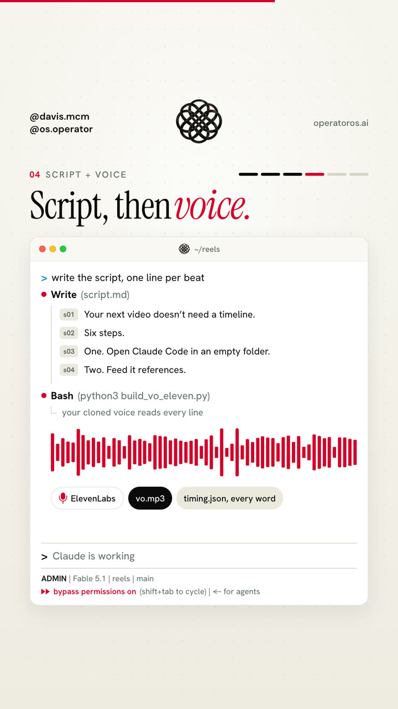

### Write the script

Every line you write becomes a scene, so write in beats. The `reel-script` skill writes `script.json` in this shape:

```json
{
  "voice_id": "your cloned voice id",
  "model": "eleven_v4",
  "speed": 1.0,
  "segs": [
    ["s01", "Video editing just became a coding problem."],
    ["s0b", "And Claude Code is really good at code."],
    ["s02", "Here's the setup. Six steps."],
    ["h02", 0.9],
    ["s03", "One. Open Claude Code in an empty folder. That's your studio."]
  ]
}
```

A `[key, "text"]` entry is spoken. A `[key, seconds]` entry is silence. Use silence after any short line that needs its own scene: nothing should hold the screen for under 2.5 seconds. The reel that sent you here is 149 words and 58.8 seconds.

### Clone your voice

1. In ElevenLabs, go to your voices and create an **Instant Voice Clone**.
2. Upload clean audio of you talking: one speaker, no music, no room echo.
3. Copy the voice ID into `script.json`.

### Voice it and time every word

Put your key in a `.env` file in the reel folder (`ELEVENLABS_API_KEY=...`), never in a file you commit. Then:

```bash
python3 scripts/build_vo.py
```

[`build_vo.py`](scripts/build_vo.py) calls ElevenLabs' text to speech with timestamps, one take per run of spoken lines, and splices the takes with your silences between them. It writes:

- `assets/vo/vo.mp3`, the voice track
- `assets/vo/timing.json`, the start and end of every line and the onset of every word

Silences split the recording into separate takes, so no cut ever lands inside a word. To change one part, edit those lines and re-voice only that take: `python3 scripts/build_vo.py --only=0`.

---

## 7. Step 5: Build it in code

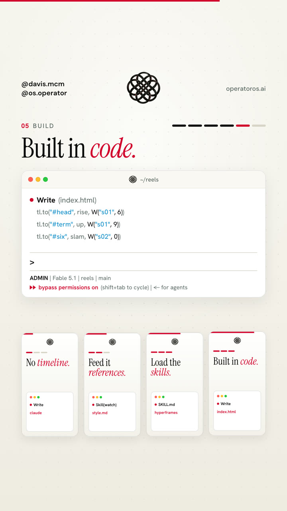

### Start from the starter

```bash
cp -R templates/starter/* .
mkdir -p scripts && cp path/to/this/guide/scripts/*.py scripts/
python3 scripts/build_vo.py
python3 scripts/apply_timing.py
npx -y hyperframes check
```

The [starter](templates/starter/index.html) is three scenes: a hook with a headline and a terminal card, one step, and a CTA. Each scene names the lines it covers:

```html
<section id="sB" class="clip" data-from="s02" data-to="s02" ...>
```

[`apply_timing.py`](scripts/apply_timing.py) reads `timing.json` and writes the real times into the file: the `SEG` and `WORDS` tables, the total duration, and every scene window. Rerun it every time the voice changes.

### Key every animation to a word

```js
const S = (k, o = 0) => SEG[k].start + o;               // when line k starts
const W = (k, i, o = 0) => SEG[k].start + WORDS[k][i] + o; // when its word i starts

rise("#head .w", S("s01"));            // headline rises as the line starts
line("#step-2", W("s02", 3));          // a row lands on the fourth word
tl.fromTo("#six", { scale: 1.6 }, { scale: 1 }, W("s02", 0));  // the 6 slams on "Six"
```

### What to ask Claude for

Give it `style.md`, the script, and the device that carries the reel. Then let it build scene by scene. The `reel-build` skill holds the rules: one section per scene, brand in CSS variables, seek-safe motion only, the Instagram safe frame (content between y 450 and 1660 on a 1080 by 1920 frame), and every frame full of real content.

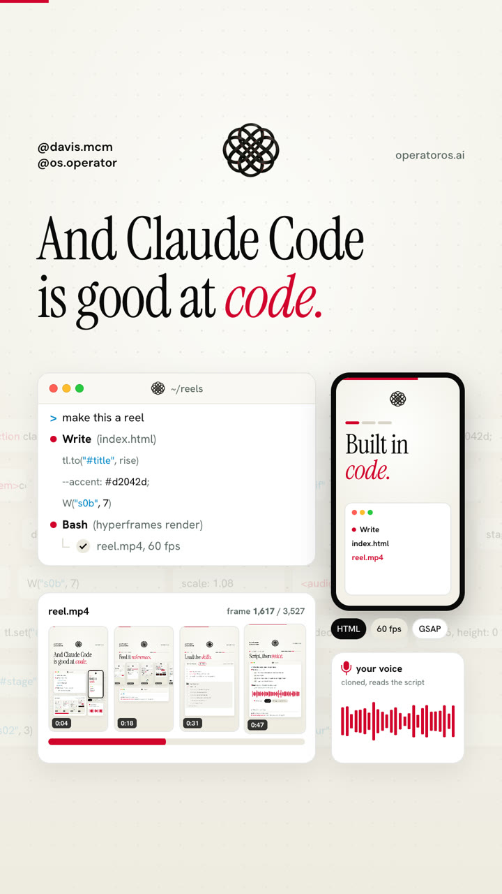

---

## 8. Step 6: Notes, then render

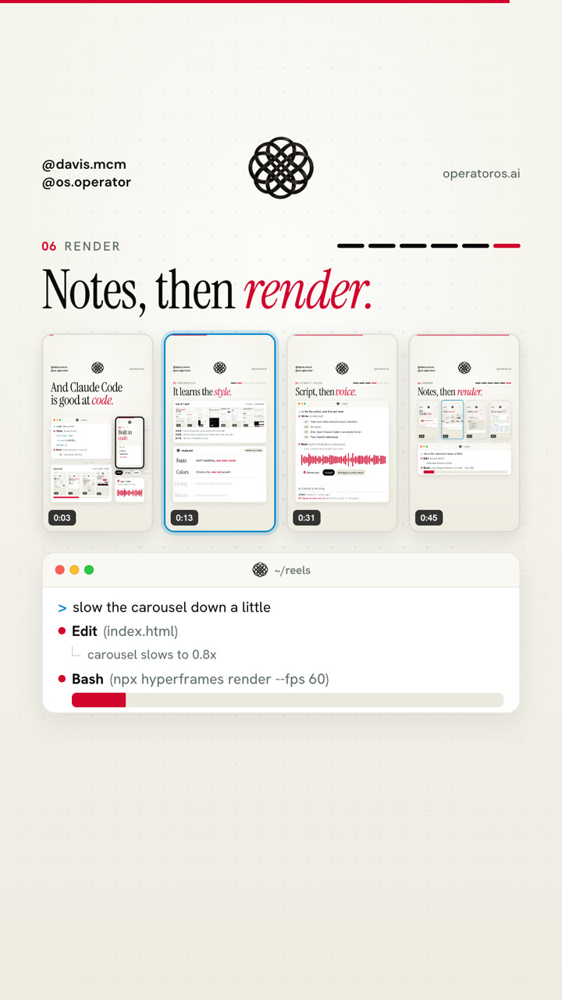

### Look before you render

```bash
npx -y hyperframes lint                     # while editing
npx -y hyperframes check                    # the gate before any render
npx -y hyperframes snapshot --at 2,8,14,20,27,33 --no-end --output snaps
```

`snapshot` writes one PNG per time and a contact sheet. Pick one time per beat from `timing.json`. Claude reads the contact sheet and fixes what it sees before you do.

### Review cuts

```bash
npx -y hyperframes render --quality looks --fps 30 --output renders/review-v1.mp4
```

Watch it. Give notes like you would to an editor: "the intro needs more color", "hold the 6 a beat longer", "the pill outline looks broken, fix it". Each round is a new version number. The reel that sent you here took seven rounds.

Keep the voice frozen during visual rounds. Rewrite lines in `script.json` as you go, then re-voice once when the visuals are done.

### The final

```bash
python3 scripts/build_vo.py
python3 scripts/apply_timing.py
npx -y hyperframes check
npx -y hyperframes render --quality delivery --fps 60 --output renders/final-60fps.mp4
ffprobe -v error -show_entries stream=codec_type -of default=nw=1 renders/final-60fps.mp4
```

The last line must print both `video` and `audio`. On an M4 Pro, the 58.8 second reel rendered in about 80 seconds as a 30 fps review cut and about two and a half minutes as the 60 fps final.

---

## 9. The prompts, in order

Paste these one at a time in the reel folder.

**Teardown**

```
Use the reel-teardown skill on reel_01.mp4, reel_02.mp4, and reel_03.mp4. Write style.md, then tell me the three things that make them work.
```

**Script**

```
Use the reel-script skill. Topic: [your topic]. Audience: [who]. CTA keyword: [WORD], they get [what]. Match the structure in style.md. Voice id: [id]. Write script.json and show me each line with an estimated duration.
```

**Voice**

```
Run python3 scripts/build_vo.py, then python3 scripts/apply_timing.py, and show me the timing table.
```

**Build**

```
Use the reel-build skill and the hyperframes skill. Build index.html from the starter. Follow style.md. The device that carries the reel is [a terminal / a phone / a step bar]. One scene per beat in script.json, every animation keyed to a word with W(). Run check, take a snapshot at one time per beat, and fix what you see before you show me.
```

**Notes**

```
Render a review cut. [Your notes in plain English.]
```

**Final**

```
Visuals are done. Re-voice once, apply timing, run check, render the 60 fps final, and verify it has video and audio.
```

---

## 10. Quick reference

**Install**

```
/plugin marketplace add bradautomates/claude-video
/plugin install watch@claude-video
```

```bash
claude plugin marketplace add heygen-com/hyperframes
claude plugin install hyperframes@hyperframes
cp -R skills/reel-teardown skills/reel-script skills/reel-build ~/.claude/skills/
npx -y hyperframes doctor
```

**Every reel**

```bash
python3 scripts/build_vo.py                 # voice + timing.json
python3 scripts/apply_timing.py             # timing into index.html
npx -y hyperframes check                    # gate
npx -y hyperframes snapshot --at 2,8,14 --no-end --output snaps
npx -y hyperframes render --quality looks --fps 30 --output renders/review-v1.mp4
npx -y hyperframes render --quality delivery --fps 60 --output renders/final-60fps.mp4
```

**Files in this folder**

- [`skills/reel-teardown/SKILL.md`](skills/reel-teardown/SKILL.md)
- [`skills/reel-script/SKILL.md`](skills/reel-script/SKILL.md)
- [`skills/reel-build/SKILL.md`](skills/reel-build/SKILL.md)
- [`scripts/build_vo.py`](scripts/build_vo.py)
- [`scripts/apply_timing.py`](scripts/apply_timing.py)
- [`templates/starter/index.html`](templates/starter/index.html) and [`templates/starter/script.json`](templates/starter/script.json)
- [`templates/style.md`](templates/style.md)

**Rules that keep reels good**

- Nothing on screen for under 2.5 seconds
- Every animation keyed to a word, never a hardcoded second
- Brand in CSS variables, so one line restyles the reel
- Content between y 450 and 1660, keywords left of x 900 below y 1180
- Voice frozen until the visuals are approved, then re-voiced once
- Borrow structure from references, never their words or assets

---

## 11. Sources

- **HyperFrames** by HeyGen, Apache-2.0: [github.com/heygen-com/hyperframes](https://github.com/heygen-com/hyperframes). Skill names and purposes from the plugin's `SKILL.md` files.
- **watch (Claude Video)** by Bradley Bonanno, MIT: [github.com/bradautomates/claude-video](https://github.com/bradautomates/claude-video). Install commands from its README.
- **ElevenLabs** plans and Instant Voice Cloning: [elevenlabs.io/pricing](https://elevenlabs.io/pricing), checked 2026-10-20. Timestamped speech: the `text-to-speech/{voice_id}/with-timestamps` endpoint.
- **GSAP**, the animation library HyperFrames drives: [gsap.com](https://gsap.com).
- Images are frames from the reel this guide ships with, built with this exact workflow.
