<p align="center">
  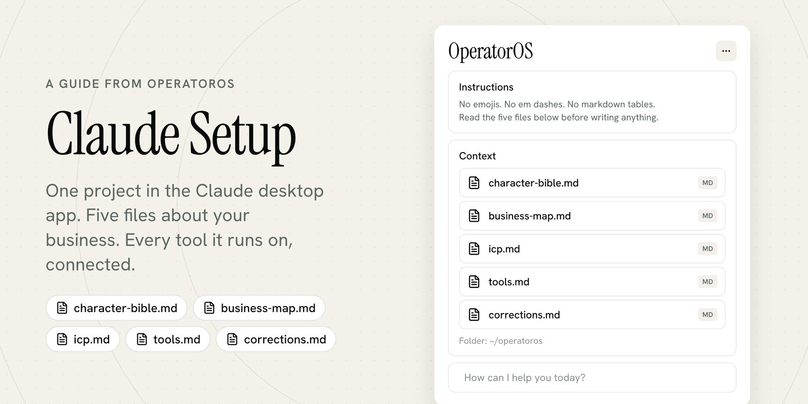
</p>

# Claude Setup: One Project, Five Files

> Follow [@davis.mcm](https://instagram.com/davis.mcm) and [@operatoros](https://instagram.com/operatoros) on Instagram for more guides like this.

---

### One project in the Claude desktop app, five short files about your business, and every tool the business runs on connected to it. After that, Claude writes like you, quotes your prices, and reads your inbox and calendar before it answers.

This is a setup guide, not a tour of features. You need no technical background. If you can write an email and copy a file, you can do all of it in a weekend. Plan an afternoon for the five files and an hour for the connectors.

Every step here is the one I would do first if I had to start over. The five files are the ones my own business runs on. The prompts that write them are the ones I used.

---

## What you'll get

→ The five files, as templates you copy: how you write, how your business works, who you sell to, which tools you run on, and what Claude got wrong

→ The prompt that writes each file from material you already have, so you fill in facts instead of writing from a blank page

→ The instructions you paste into the project, so Claude reads the files before every draft and asks instead of guessing a price

→ The connectors step, with the exact clicks in the desktop app, so Claude reads your email, calendar, and documents live

→ Three things to ask it on Monday morning, worded so the first result is useful

→ [`scripts/new-claude-setup.sh`](scripts/new-claude-setup.sh), one command that puts the templates in a folder of your own, plus my real [business map](example/business-map.md) as a worked example

---

## Prerequisites

- The Claude desktop app, signed in. Projects work on every plan. A free account can have five of them ([help center](https://support.claude.com/en/articles/9517075-what-are-projects)).
- Your sent email. The character bible is written from it, either through the Gmail connector or from twenty emails you paste in.
- Your price list, your website, and two or three recent proposals or invoices. The business map is written from those.
- Ten minutes of notes on your last ten clients and five leads you turned down. The ICP file is written from those.
- Nothing else. No code, no terminal, unless you want the one-command install in section 10.

---

## Contents

1. [Why a new chat knows nothing about your business](#1-why-a-new-chat-knows-nothing-about-your-business)
2. [One project](#2-one-project)
3. [The instructions](#3-the-instructions)
4. [File 1: character-bible.md](#4-file-1-character-biblemd)
5. [File 2: business-map.md](#5-file-2-business-mapmd)
6. [File 3: icp.md](#6-file-3-icpmd)
7. [File 4: tools.md](#7-file-4-toolsmd)
8. [The step everyone skips: connectors](#8-the-step-everyone-skips-connectors)
9. [File 5: corrections.md](#9-file-5-correctionsmd)
10. [Put it together](#10-put-it-together)
11. [Monday morning](#11-monday-morning)
12. [Keep it current](#12-keep-it-current)
13. [Pro tips](#13-pro-tips)
14. [Limitations](#14-limitations)
15. [Quick reference](#15-quick-reference)
16. [Sources](#16-sources)

---

## 1. Why a new chat knows nothing about your business

<p align="center">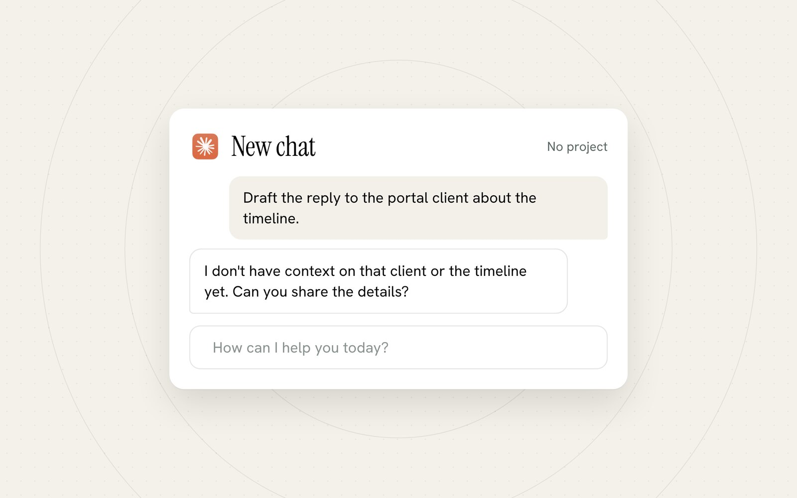</p>

Open a new chat and ask Claude to reply to a client about a timeline. It asks you who the client is. It does not know your prices, your turnaround, how you sign your emails, or which clients you would rather not have. Nothing is wrong. It only knows what it has been given.

So most people give it the same things every day. They paste in how the business works, fix the voice when the draft sounds like a brochure, fix the price when it offers something for free, and do it all again tomorrow in a fresh chat.

Claude does keep a memory of your chats, and it is on by default on Free, Pro, Max, and Ultra ([help center](https://support.claude.com/en/articles/11817273-use-claude-s-chat-search-and-memory-to-build-on-previous-context)). Memory is a summary Claude writes about you over time. It is useful, and it is not the same as five files you wrote, can read line by line, can fix in one place, and can hand to the next person you hire. This guide builds the files. Memory keeps working on top of them.

---

## 2. One project

<p align="center">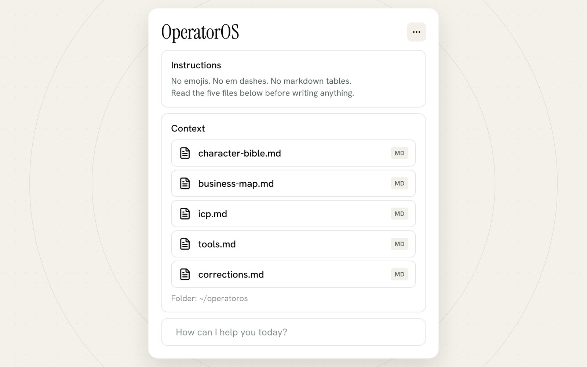</p>

A project is a container for chats. Whatever you put in it is there at the start of every chat you open inside it, so you stop re-explaining yourself. A project has two parts, and this guide fills both.

- **Instructions.** A short set of rules every chat reads first. What to read, in which order, and what never happens. Section 3.
- **Context.** The files. Your five files live here. Sections 4 to 9.

The help center calls these "project instructions" and "project knowledge" ([how to create and manage projects](https://support.claude.com/en/articles/9519177-how-can-i-create-and-manage-projects)). The desktop app labels the panels Instructions and Context. Same two things.

To create it: in the desktop app, Projects sit in the left sidebar. Click the plus next to Projects and name it after your business. You will come back to it in section 10 with the files in hand.

---

## 3. The instructions

Short and absolute. Paste [`templates/project-instructions.md`](templates/project-instructions.md) into the Instructions panel with the two bracketed names replaced. The full text:

```
You write as [Your Name], owner of [Business].

Before every draft, read these files in this order:
1. character-bible.md. How I write.
2. business-map.md. What we sell, what it costs, how a job moves, what the client owns.
3. icp.md. Who we work with and who we turn down.
4. tools.md. The tools the business runs on. If one is connected, read it instead of asking me.
5. corrections.md. Every mistake I have logged. Do not repeat one.

Rules that never bend:
- Prices, timelines, and what is included come from business-map.md. If the map does not say, ask me. Never invent a number.
- Sound like character-bible.md: the greeting, the closing line, the sign-off, and the words I never use.
- Before a quote or a proposal, check the person against icp.md. If they do not fit, say so before you draft.
- When something is wrong, write the entry for corrections.md: what you did, what I wanted, why.
- No emojis. No em dashes. Plain words.

Before showing a draft, say in one line which files you read.
```

The last line is the receipt. If a draft arrives without "Read character-bible.md, business-map.md, icp.md" above it, the project did not load and you should not trust the numbers in it.

Rules go in the instructions. Facts go in the files. A rule in the instructions is read before any file, so "never invent a number" cannot get buried under a long price list. Everything with detail, the prices themselves, the tone, the customer, goes in a file where you can edit it without touching the rules.

---

## 4. File 1: character-bible.md

<p align="center">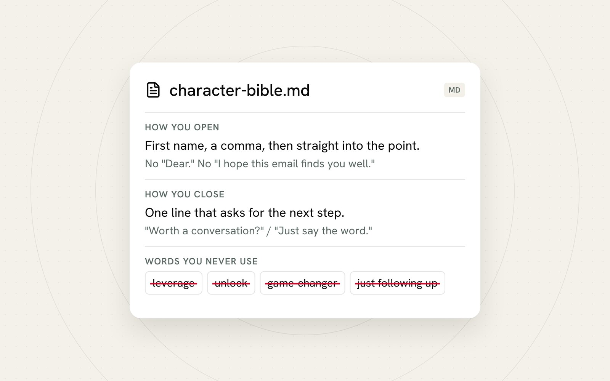</p>

How you write, taken from emails you already sent. Not a description of yourself. Descriptions produce "professional yet friendly," which is how every brochure sounds. Your sent folder produces the truth: you open with the first name and a comma, you never write "I hope this email finds you well," you close by asking for the next step, and you sign off the same way every time.

Template: [`templates/character-bible.md`](templates/character-bible.md). The prompt sits at the top of it:

```
Read the last sixty emails I sent. Skip newsletters and anything automated.
Write my character bible from them, using the headings in character-bible.md.
Rules: every example is a line I actually wrote, quoted. Nothing invented.
Where my habits differ by situation (a new lead, a current client, a late payment, saying no), say so.
```

Two ways to run it. With the Gmail connector on (section 8), paste the prompt as written and Claude reads the sent mail itself. Without it, copy twenty sent emails into the chat first and change the first line to "Here are twenty emails I wrote."

What comes back goes under the template's headings: how I open, how I close, sentence habits, words I reach for, words I never use, tone by situation. Delete any example line you did not write. The file is only as good as its quotes.

The test, once it is in the project: ask for a reply to a real client email. The sign-off should be yours before you have said a word about it.

---

## 5. File 2: business-map.md

<p align="center">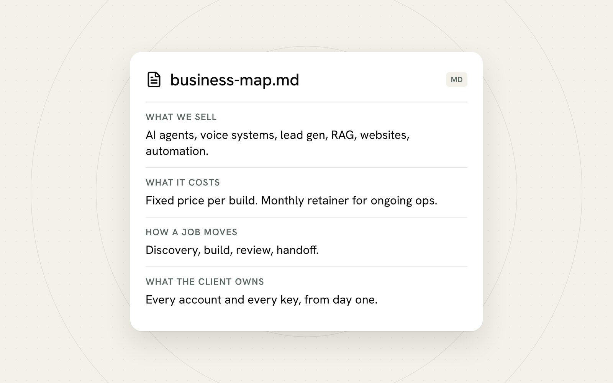</p>

The operating facts. What you sell, what it costs, how a job moves from first contact to done, and what the client owns at the end. Every quote and every proposal is checked against this page, so a number that is not on it does not exist.

Template: [`templates/business-map.md`](templates/business-map.md). The prompt:

```
Here are our website, price list, recent proposals, and the contract. Write the business map using the headings in business-map.md.
Rules: only facts that appear in what I gave you. If a heading has no source, write "TBD" under it and list the question I need to answer.
Prices exactly as written, with currency. No ranges you made up. No guarantees we did not state.
```

Attach the website, the price list, two or three proposals or invoices, and your contract if you use one. The prompt tells Claude to write TBD wherever your material is silent. Fill every TBD by hand. This is the one file where a guess costs money.

The last heading in the template is "Facts Claude must never invent." Prices and discounts, delivery dates, guarantees and refund terms, who does what. Leave it in. It is the list Claude checks when the instructions say "if the map does not say, ask me."

My own map, trimmed to what is public, is in [`example/business-map.md`](example/business-map.md). Six offers, two pricing rules, a six-step job, and what the client owns. It is short on purpose. A business map is a page, not a handbook.

---

## 6. File 3: icp.md

<p align="center">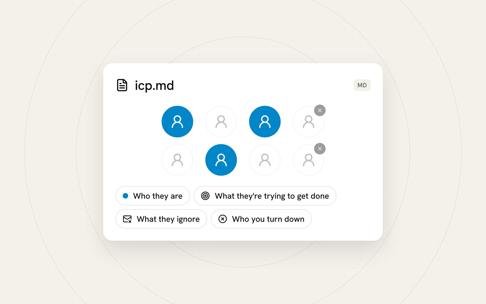</p>

ICP is your ideal customer profile. Four things: who they are, what they are trying to get done, what they ignore, and who you turn down. The fourth is the one that saves the most time. A lead that looks good and ends badly usually shows the same sign early, and once that sign is written down, Claude can point at it before you have spent an hour on a quote.

Template: [`templates/icp.md`](templates/icp.md). The prompt:

```
Here are my last ten clients and five leads I turned down. Write the ICP file using the headings in icp.md.
Rules: describe the pattern you actually see, not an ideal. Quote my notes where they explain a yes or a no.
If the ten clients split into two clear groups, write both and tell me which one paid more.
```

The input is ten short notes: what the client does, how they found you, what they bought, and whether you would take them again. Plus five you said no to and why. Twenty minutes of typing. The prompt asks for the pattern in those notes, not for a wish list.

The template ends with three questions Claude asks before every quote. Does this person match who they are. Are they asking for the job they are trying to get done. Is anything from "who you turn down" present. If the third answer is yes, the instructions make it say so before it drafts.

---

## 7. File 4: tools.md

<p align="center">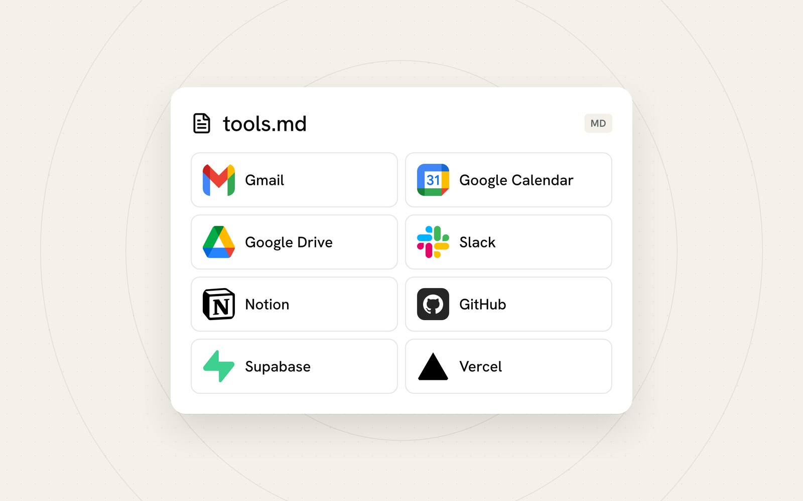</p>

Every tool the business runs on, what lives in each, and whether it is connected to Claude. Email, calendar, files, messages, the customer list, invoicing, project notes, booking, the website. The list is the input to section 8, which is the step that changes what Claude can do.

Template: [`templates/tools.md`](templates/tools.md). If email and calendar are already connected, the prompt at the top writes the list for you:

```
Read my sent mail and my calendar from the last ninety days. List every app, service, or website the business uses: anything I link to, log in to, send invoices from, book through, or share files with.
For each one write what lives in it in five words or fewer. Use the headings in tools.md.
```

If nothing is connected yet, write the list by hand. The template has a checklist by category so the booking page and the accounting app do not get forgotten. The eight on the card above are the top of my own list.

---

## 8. The step everyone skips: connectors

<p align="center">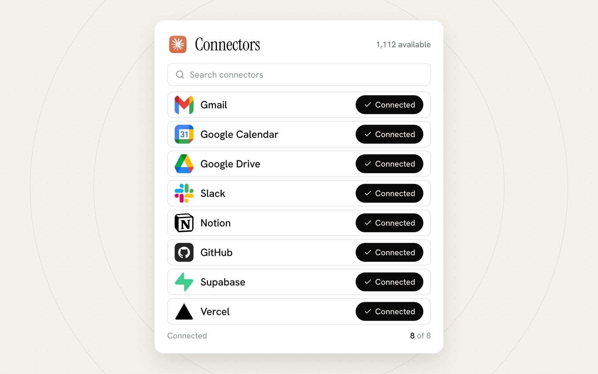</p>

Until now, Claude knows what you pasted in. A connector lets it read the tool itself. The official description: connectors let Claude access your apps and services, retrieve your data, and take actions within connected services ([help center](https://support.claude.com/en/articles/11176164-use-connectors-to-extend-claude-s-capabilities)). In practice: you ask what is happening with a client this week, and the answer comes from the calendar, the email thread, and the folder, read at that moment.

Take tools.md to the directory and connect every tool on it that is listed. The clicks, from Anthropic's own page ([get started with connectors](https://claude.com/docs/connectors/getting-started)):

1. In the desktop app, select **Customize** in the sidebar, then **Connectors**.
2. Select **Discover** to browse the directory. Search for each tool on your list.
3. Open the tool and select **Connect to Claude**. Sign in to that tool when it asks.
4. Back in tools.md, mark the tool connected.

Start with email, calendar, and files. Those three cover most of what a business asks about. Then work down the list. The directory listed 1,112 connectors when I read it on November 11, 2026 ([claude.com/connectors](https://claude.com/connectors)), and the common ones, Gmail, Google Calendar, Google Drive, Slack, Notion, HubSpot, Stripe, were all on the page.

Three facts worth knowing before you start, all from the help center page linked above:

- Web connectors are available for all users on Claude, Cowork, Claude Desktop, and Claude Mobile. No plan upgrade is needed to connect a listed tool.
- On Team and Enterprise plans, an Owner has to enable connectors for the organization before members can use them. If the Connect button is missing, that is why.
- The tool you connect may need its own account or paid plan on that tool's side. Claude connects to the account you already have.

Claude can ask for your approval before it uses a connector's tools, so the first few times you will see it check with you before it reads or sends anything. Say yes to reading. Think before you say yes to sending.

<p align="center">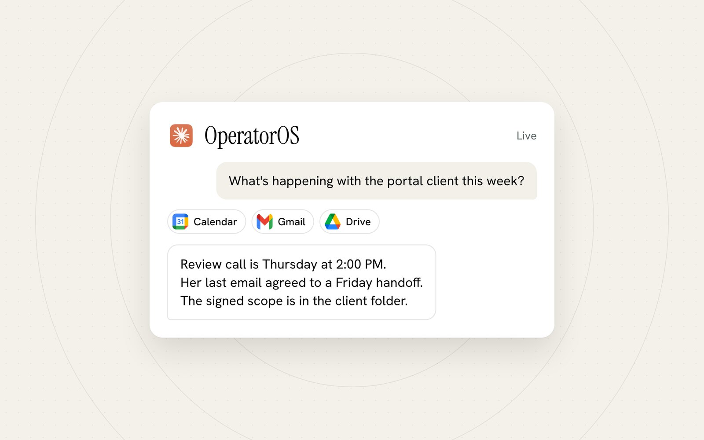</p>

That card is the difference. The question is the same one from section 1. The answer now has a meeting time from the calendar, a commitment from the last email, and the location of the signed document, none of which you typed.

---

## 9. File 5: corrections.md

<p align="center">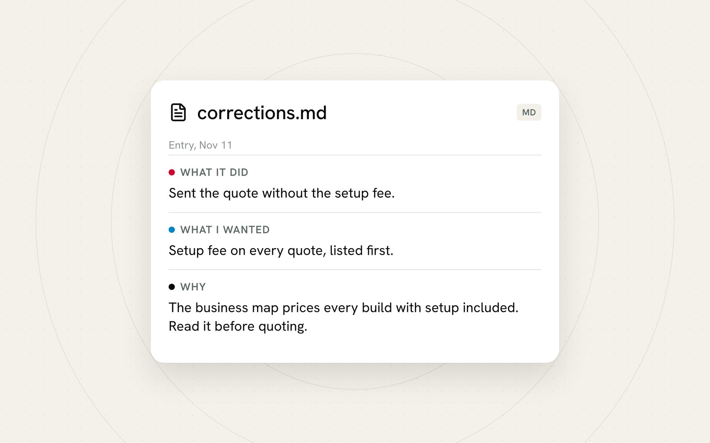</p>

The file that makes the setup get better instead of staying the same. One entry per mistake, three fields: what Claude did, what you wanted, and why. Claude reads it at the start of every chat, so a mistake logged once is not made twice.

Template: [`templates/corrections.md`](templates/corrections.md). You do not write the entries. When a draft is wrong, say so and ask for the entry:

```
That is wrong. Write the corrections.md entry: what you did, what I wanted, why.
```

Copy what comes back to the bottom of corrections.md, then replace the file in the project's Context so the next chat reads the new version. The "why" field is the one that matters. "The business map prices every build with setup included. Read it before quoting." tells Claude which file it should have read, which is how the same mistake stops showing up in a different form.

The corrections file is the one that grows. Mine held 52 entries on October 9, 2026. The count is the point.

---

## 10. Put it together

Everything above, in the order to do it.

**Get the templates.** On GitHub, use the green Code button, then Download ZIP. Inside the download, copy `guides/claude-setup/templates` somewhere you will keep it, named after your business. Or, if you are comfortable with a terminal:

```bash
git clone https://github.com/davisxai/operator-knowledge-base.git
bash operator-knowledge-base/guides/claude-setup/scripts/new-claude-setup.sh ~/claude-setup
```

The script copies the six files into `~/claude-setup`, stamps today's date into corrections.md, and starts a git history if git is installed. It refuses to overwrite a folder that already exists. Pass a different path as the first argument to put it somewhere else.

**Build the project.**

1. In the desktop app, click the plus next to Projects. Name it after your business.
2. Open Instructions. Paste `project-instructions.md` with the two bracketed names replaced. Save.
3. Open Context. Add `character-bible.md`, `business-map.md`, `icp.md`, `tools.md`, and `corrections.md`. They are templates for now. That is fine.

**Fill the files, inside the project.**

4. Connect Gmail first (section 8), so the character bible prompt can read your sent mail. Skip this if you would rather paste emails.
5. Start a chat in the project. Run the character bible prompt. Paste the result into `character-bible.md` on your computer, cut what is not you.
6. New chat. Attach the price list and proposals. Run the business map prompt. Fill every TBD.
7. New chat. Paste the client notes. Run the ICP prompt. Edit until every line is true.
8. New chat. Run the tools prompt, or write the list from the checklist.
9. Replace the four files in Context with the filled versions. One copy of each.

**Connect the tools.**

10. Walk tools.md through Customize, Connectors, Discover. Mark each one connected.

**Check it.**

11. New chat. Ask: "Which files will you read before drafting, and what is my sign-off?" The answer should name the five files and quote the sign-off from your bible. If it does not, the Instructions or the Context did not save.

---

## 11. Monday morning

<p align="center">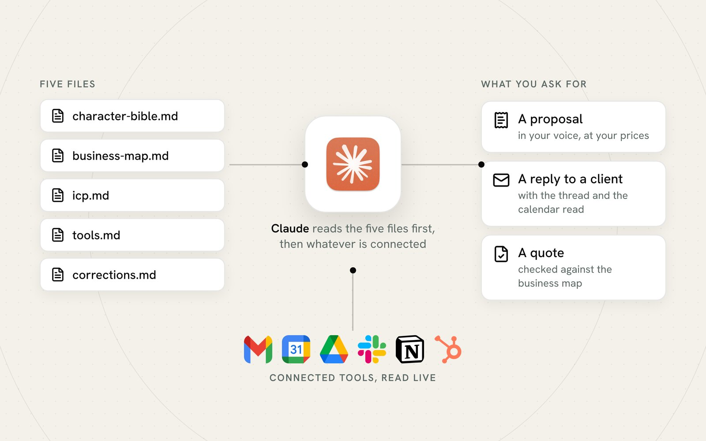</p>

Three asks, worded so the first result is worth sending. Use the real names.

**A proposal for the person you spoke to last.**

```
Write a proposal for [name] at [company] for [the job]. Use the call notes in [folder or thread].
Prices from the business map. My voice from the bible. Before drafting, check them against icp.md and tell me if anything is off.
```

The draft comes back in your sentences, with your prices, and with a line above it saying which files it read. If the person trips a "who you turn down" sign, you hear that first.

**A reply to the thread you have been avoiding.**

```
Read my last thread with [name]. Draft the reply. Check the calendar before you commit me to a date.
```

With Gmail and the calendar connected, it reads the thread and the calendar before writing. Without them, paste the thread in and the sentence still holds.

**A quote check.**

```
Here is a quote I am about to send. Check every number against business-map.md and list anything that is not on the map.
```

This is the ask that pays for the afternoon you spent on the files. A quote with a price that is not on the map gets flagged before the client sees it.

Then the ordinary work. Every chat in the project reads the five files first, so the ordinary work arrives in your voice with your facts, and when it does not, section 9 is the fix.

---

## 12. Keep it current

- **Edit on your computer, replace in Context.** The files in the project are copies. When a price changes, change business-map.md, then replace it in Context. One copy, always.
- **Corrections are the maintenance.** The other four files change rarely. corrections.md grows with every miss, and that growth is the setup getting better.
- **Re-run the character bible prompt once a year,** or when you start writing to a new kind of customer. Same prompt, newer emails, read what changed.
- **Re-check tools.md when you add a tool.** New booking page, new accounting app. Add it to the list, then to the connectors.
- **Numbers live in one file.** If you find yourself typing a price into the instructions or into a chat, stop and put it in the business map instead.

---

## 13. Pro tips

> [!TIP]
> **Write the files from material, never from memory.** Sent emails, the price list, client notes. A file written from a description of your business reads like a description of your business. A file written from your own emails reads like you.

> [!TIP]
> **Keep the instructions under a screen.** If you are adding a paragraph to Instructions, it belongs in a file, and the instructions should say which file to read.

> [!TIP]
> **Ask for the receipt.** The last instruction makes Claude name the files it read before every draft. When that line is missing, the project did not load. Fix that before you fix the draft.

> [!TIP]
> **Connect three tools before you connect fifteen.** Email, calendar, files. Use the project for a week. Then connect the rest, because by then you will know which questions you actually ask.

> [!TIP]
> **One correction, one entry.** Do not rewrite the bible every time a draft misses. Log the entry, replace the file, move on. After a month, read the entries together. The ones that repeat are rules for the instructions.

> [!TIP]
> **Share the folder, not the login.** When someone joins, they get the five files and their own project. The files are the handbook you never had time to write.

---

## 14. Limitations

- **Nothing syncs by itself.** The files in Context are copies of the files on your computer. Edit one and forget to replace it, and Claude reads the old version. The replace step is a habit you have to build.
- **Connectors read what your account can see.** The permissions in the tool still apply, and Claude may ask for approval before each read or action. That is the design, and it means the first week has more clicks than the second.
- **A fact in a file can still be misread.** Five files cut the mistakes sharply. They do not take them to zero. The quote check in section 11 exists for this reason, and corrections.md is where the misses go.
- **Memory and corrections are different things.** Claude's memory is a summary it maintains, and you can view it from the project page. corrections.md is a record you own in full. Keep using both; do not expect memory to replace the file.
- **Project knowledge has a size.** Five one-page files fit on any plan. Paid plans get an expanded knowledge capacity ([help center](https://support.claude.com/en/articles/9517075-what-are-projects)). If you start adding a year of contracts to Context, you will hit the limit on Free and should move those to a connected folder instead.
- **Not every tool is in the directory.** When one is missing, tools.md has a section for how Claude gets the data anyway: an export, a PDF, a forwarded email.

---

## 15. Quick reference

**The five files**
- `character-bible.md`, how you write, from your sent mail
- `business-map.md`, what you sell, what it costs, how a job moves, what the client owns
- `icp.md`, who they are, what they are trying to get done, what they ignore, who you turn down
- `tools.md`, every tool the business runs on, and whether it is connected
- `corrections.md`, what it did, what I wanted, why

**Read order** (from project-instructions.md)
character bible, business map, ICP, tools, corrections. Then the receipt line: which files were read.

**Create the project**
Desktop app, plus next to Projects. Instructions: paste `project-instructions.md`. Context: add the five files.

**Connect a tool**
Customize in the sidebar, Connectors, Discover, open the tool, Connect to Claude.

**The prompts**
Top of each template. Character bible reads sixty sent emails. Business map reads the price list and proposals. ICP reads ten clients and five refusals. Tools reads ninety days of mail and calendar.

**The correction**
"That is wrong. Write the corrections.md entry: what you did, what I wanted, why." Paste it in, replace the file.

**Monday asks**
A proposal for the last person you spoke to. A reply to the thread you have been avoiding. A quote check against the map.

**Install**
```bash
git clone https://github.com/davisxai/operator-knowledge-base.git
bash operator-knowledge-base/guides/claude-setup/scripts/new-claude-setup.sh ~/claude-setup
```

**The designer's version**
If your business also needs a brand kit and a company voice separate from your own, [guides/ai-brain](../ai-brain/) is the same idea with those two files added.

---

## 16. Sources

- Projects on every plan, five on free, and the expanded knowledge capacity on paid plans: Anthropic help center, [What are projects?](https://support.claude.com/en/articles/9517075-what-are-projects)
- Creating a project, "Set project instructions", project knowledge: [How can I create and manage projects?](https://support.claude.com/en/articles/9519177-how-can-i-create-and-manage-projects)
- What connectors do, who can use them, the Team and Enterprise owner step: [Use connectors to extend Claude's capabilities](https://support.claude.com/en/articles/11176164-use-connectors-to-extend-claude-s-capabilities)
- The desktop click path, Customize, Connectors, Discover, Connect to Claude, and the approval note: [Get started with connectors](https://claude.com/docs/connectors/getting-started)
- The connector count, 1,112, read on the directory page on November 11, 2026: [claude.com/connectors](https://claude.com/connectors)
- Memory on by default and project memory: [Use Claude's chat search and memory to build on previous context](https://support.claude.com/en/articles/11817273-use-claude-s-chat-search-and-memory-to-build-on-previous-context)
- The AI Brain guide, where the character bible and customer files first shipped: [guides/ai-brain](../ai-brain/)

---

Built by OperatorOS | [operatoros.ai](https://operatoros.ai)
Follow [@davis.mcm](https://instagram.com/davis.mcm) and [@operatoros](https://instagram.com/operatoros) for production-grade AI guides.
