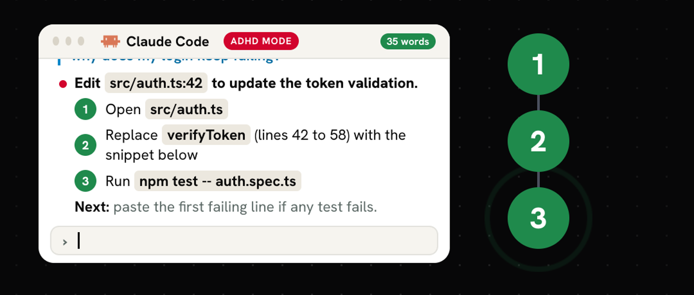
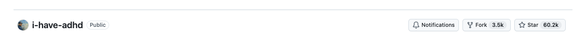
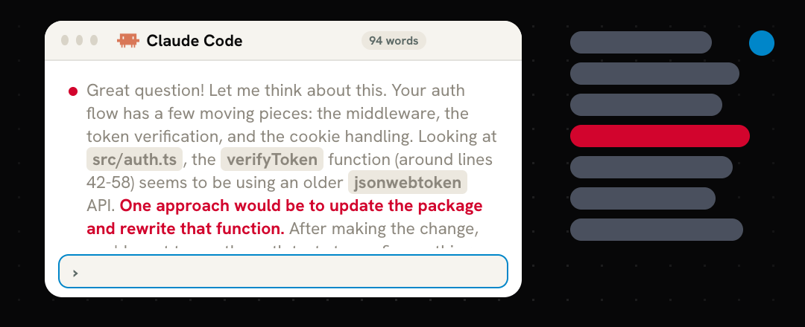
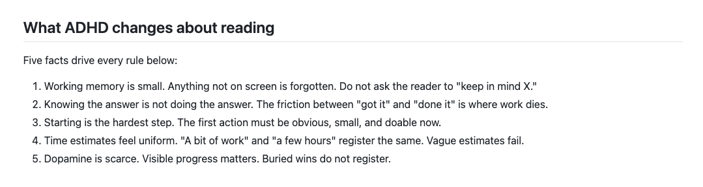
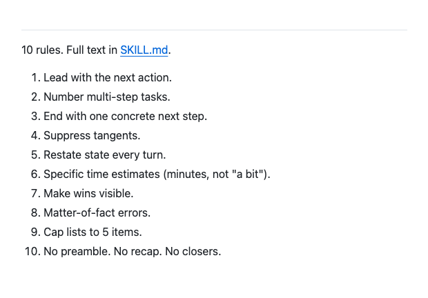
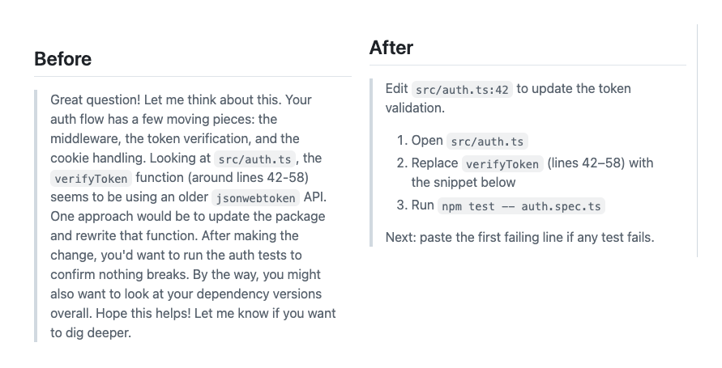
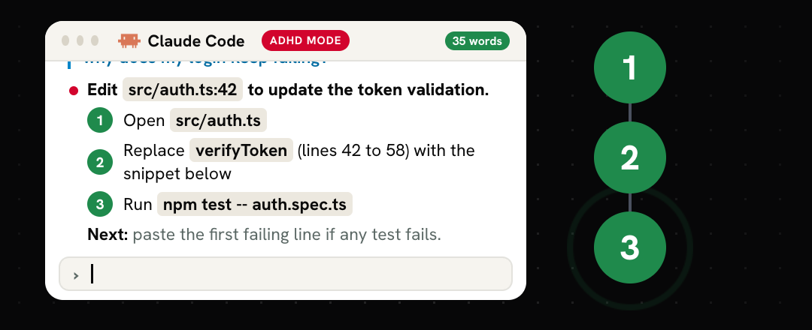
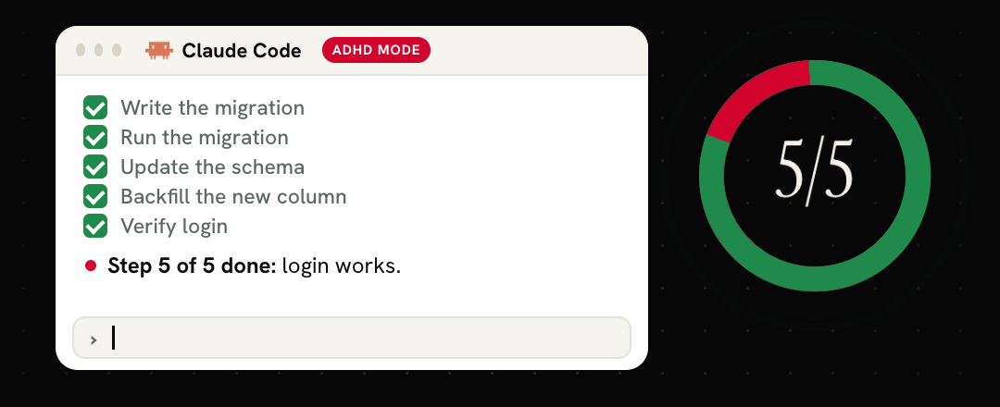
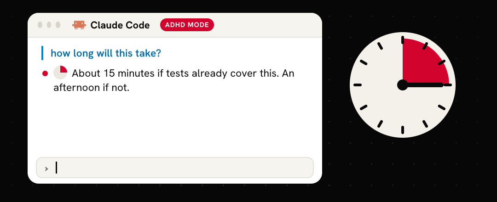

# i-have-adhd: ADHD-Friendly Output for Your AI

> Follow [@os.operator](https://instagram.com/os.operator) and [@davis.mcm](https://instagram.com/davis.mcm) on Instagram for more guides like this.

### The repo, all ten rules, and how to run it in Claude Code.

i-have-adhd is a free, MIT-licensed skill by ayghri ([github.com/ayghri/i-have-adhd](https://github.com/ayghri/i-have-adhd)) that changes how your coding agent formats every response: the next action first, steps numbered, no preamble, no recap, no closers. This guide covers what it does, why each rule exists, how to install it, and how to check it is working.

**What you'll get:**

→ The install for Claude Code, plus an install script in this folder
→ All ten rules, with the five facts about ADHD that each one comes from
→ The real before and after from the repo, and how to read the difference
→ A paste-in `CLAUDE.md` version of the rules for any project
→ Five test prompts to confirm it is on, and how to turn it off
→ What the repo's own evals measured, including where it got worse

> [!IMPORTANT]
> **Prerequisites:**
> 1. Claude Code installed (`claude` on your path). Codex, Cursor, Gemini, Antigravity, and others are supported too; see the repo's [INSTALL.md](https://github.com/ayghri/i-have-adhd/blob/main/INSTALL.md).
> 2. Nothing else. No account, no key, no cost beyond the model you already use.



---

## Table of Contents

1. [The problem](#1-the-problem)
2. [Why this changes things](#2-why-this-changes-things)
3. [How it works: five facts, ten rules, one check](#3-how-it-works-five-facts-ten-rules-one-check)
4. [The ten rules](#4-the-ten-rules)
5. [Before and after](#5-before-and-after)
6. [Install it in Claude Code](#6-install-it-in-claude-code)
7. [Make it always-on](#7-make-it-always-on)
8. [Use cases](#8-use-cases)
9. [What the evals say](#9-what-the-evals-say)
10. [Pro tips](#10-pro-tips)
11. [Limitations](#11-limitations)
12. [Quick reference](#12-quick-reference)
13. [Sources](#13-sources)

---

## 1. The problem

You ask one simple question. Before the answer, you read a compliment on the question, a recap of what you asked, and a side note about something you never brought up. The part you can act on is buried in the middle, and the reply ends with "Hope this helps! Let me know if you want to dig deeper."



For an ADHD brain that order is backwards. The hardest part is starting, and every sentence before the first action is one more place to lose the thread.

---

## 2. Why this changes things

> [!NOTE]
> **The first line is something you can do.** Not context, not a plan. A command, a path, or an edit. You can start before you finish reading.

> [!NOTE]
> **Work comes in numbered, bounded steps.** One action per step, the fewest steps that still work. The skill's own line: "A short path finished beats a complete path abandoned."

> [!NOTE]
> **It tells you where you are, every turn.** "Step 3 of 5 done: schema updated. Next: backfill the new column." You never have to hold the plan in your head.

> [!NOTE]
> **Estimates come in minutes.** "About 15 minutes if tests already cover this. An afternoon if not." Not "this will take some work."

---

## 3. How it works: five facts, ten rules, one check

The skill file is short and it reasons out loud. Every rule traces back to one of five facts about how ADHD changes reading:



1. **Working memory is small.** Anything not on screen is forgotten. So the reply restates state and never asks you to "keep in mind X."
2. **Knowing the answer is not doing the answer.** The gap between "got it" and "done it" is where work dies. So every reply ends with one concrete next action.
3. **Starting is the hardest step.** So the first action must be obvious, small, and doable now.
4. **Time estimates feel uniform.** "A bit of work" and "a few hours" register the same. So estimates are concrete.
5. **Dopamine is scarce.** Visible progress matters. So finished work is shown, not buried in a recap.

Then, before any reply goes out, it runs one check from the skill file: if you read only the first line and the last line, do you know what to do next and what just happened? If yes, send.

It also persists. Once on, the rules apply to every response for the rest of the session until you say `stop adhd mode` or `normal mode`.

---

## 4. The ten rules



1. **Lead with the next action.** The first line is something you can do.
2. **Number multi-step tasks.** Each step is one bounded action. No step says "and then" twice.
3. **End with one concrete next step.** Something doable in under two minutes.
4. **Suppress tangents.** Finish the first issue, then offer the second as a separate question.
5. **Restate state every turn.** "Step 3 of 5 done."
6. **Specific time estimates.** Minutes or hours, with the condition.
7. **Make wins visible.** Show what now works, in concrete terms.
8. **Matter-of-fact errors.** Location, cause, fix. No "uh oh."
9. **Cap lists to 5 items.** Group and rank; keep the rest in reserve. This shapes presentation only, it never limits the analysis.
10. **No preamble, no recap, no closers.** Start with the answer. End when the answer is done.

The skill also lists when to break the rules: when you ask it to explain, before anything destructive, after three failed fixes in a row, when the request is ambiguous, and when a rule would delete the answer itself.

---

## 5. Before and after

This is the repo's own example. Same question about a broken auth flow, skill off and skill on:



What to notice:

- **Before** is 94 words. The actionable sentence ("update the package and rewrite that function") is the fourth of seven. It ends on two closers.
- **After** is 35 words. Line one is the edit and the file. Three numbered steps. The last line is the next action if a test fails.



---

## 6. Install it in Claude Code

Commands from the repo's [INSTALL.md](https://github.com/ayghri/i-have-adhd/blob/main/INSTALL.md):

**Step 1.** Add the marketplace and install the plugin.

```bash
claude plugin marketplace add ayghri/i-have-adhd
claude plugin install i-have-adhd@i-have-adhd
```

Or run the script in this folder, which does the same and checks that `claude` is installed:

```bash
bash scripts/install-claude-code.sh
```

**Step 2.** Confirm it is there.

```bash
claude plugin list
```

**Step 3.** Restart Claude Code and turn it on in a session.

```
/i-have-adhd
```

**Step 4.** Run the [test prompts](templates/test-prompts.md). Check the first line and the last line of each reply.

**Step 5.** Turn it off for the session when you want a normal reply.

```
stop adhd mode
```

**Step 6.** Update it later.

```bash
claude plugin marketplace update i-have-adhd
claude plugin update i-have-adhd@i-have-adhd
```

---

## 7. Make it always-on

The plugin ships a `SessionStart` hook that loads the rules at the start of every session, but only when a flag file exists. Installing alone changes nothing.

```bash
touch ~/.claude/.i-have-adhd-always
```

Or install and enable it in one go:

```bash
bash scripts/install-claude-code.sh --always
```

Back to on-demand:

```bash
rm ~/.claude/.i-have-adhd-always
```

**No plugin, any tool:** paste [`templates/CLAUDE-adhd-rules.md`](templates/CLAUDE-adhd-rules.md) into a project's `CLAUDE.md` (or your tool's equivalent instructions file). It is the compact always-on version of the rules from the repo's INSTALL.md.

---

## 8. Use cases

<details>
<summary><strong>Debugging</strong></summary>

Errors come back as location, cause, fix. After three replies of "still broken," the skill stops iterating on code, names the assumption that might be wrong, and asks one diagnostic question.

</details>

<details>
<summary><strong>Multi-step builds and migrations</strong></summary>

This is where the evals show the biggest gain. Every turn restates progress ("Step 3 of 5 done: schema updated. Next: backfill the new column. Run the script?") so you can say yes and keep going. Each yes closes a step and names the next one.



</details>

<details>
<summary><strong>Planning and estimates</strong></summary>

Ask how long something takes and you get a number with its condition. "What are my options" still gets two to four ranked options, recommendation first, because the skill lets the task win when a rule would delete the answer.



</details>

<details>
<summary><strong>Learning and explanations</strong></summary>

Say "explain" or "walk me through" and it explains fully, with headers so you can skim back. Still no preamble and no closer.

</details>

---

## 9. What the evals say

The repo ships an eval harness and publishes its first recorded run in [evals/RESULTS.md](https://github.com/ayghri/i-have-adhd/blob/main/evals/RESULTS.md) (2026-08-02, 14 cases, 3 trials each, blind judge):

- **Weighted score:** 4.045 without the skill, 4.473 with it.
- **Wins:** 10 of 14 cases, 2 ties, 2 losses.
- **Biggest gains:** multi-step progress and error reports, the cases about reporting state.
- **Concision:** 3.43 to 4.57. Correctness and safety also moved up, so the brevity is not bought with accuracy.
- **Unchanged where the task sets the shape:** code answers and long-form requests.
- **Got worse:** an agent-owned edit case and a partial-success case.
- **Release gate:** recorded as failed, because the gate allows zero blocking findings and the skill cut them from 7 to 3 but not to zero.

The repo publishes the failures alongside the wins. Read the file before you treat any of it as settled.

---

## 10. Pro tips

> [!TIP]
> **Judge it by the first and last line.** That is the skill's own pre-send check. If both tell you what happened and what to do next, it is working.

> [!TIP]
> **Use always-on only if you want it everywhere.** On-demand with `/i-have-adhd` keeps normal replies available for long explanations and writing.

> [!TIP]
> **Say yes to the loop.** In multi-step work, answering "yes" to "Run the script?" closes the step and gets you the next one. Each step done is visible on screen.

> [!TIP]
> **Fork it to tune it.** Edit `skills/i-have-adhd/SKILL.md` in your fork and bump `version` in `.claude-plugin/plugin.json`, or `claude plugin update` will skip it.

> [!TIP]
> **No ADHD diagnosis needed.** The repo's tagline. The rules make any agent easier to act on.

---

## 11. Limitations

- **It shapes output, it does not treat anything.** The repo says the rules are adapted for how an LLM should respond, not how a person should organize their day. It is loosely based on *The Adult ADHD Tool Kit* by J. Russell Ramsay and Anthony L. Rostain.
- **The evals show regressions.** Two of fourteen cases scored lower with the skill on. See section 9.
- **Your harness outranks it.** Inside an agent harness, the system prompt wins over the skill when they conflict.
- **Lists are capped at five on screen.** The skill keeps the rest in reserve and shows them when asked. If you want everything at once, ask for it.
- **Persistence is per session.** On-demand mode resets with a new session unless the always-on flag file exists.

---

## 12. Quick reference

- **Install:** `claude plugin marketplace add ayghri/i-have-adhd` then `claude plugin install i-have-adhd@i-have-adhd`
- **Turn on:** `/i-have-adhd`
- **Turn off for the session:** `stop adhd mode` or `normal mode`
- **Always-on:** `touch ~/.claude/.i-have-adhd-always` (remove the file to undo)
- **Check it is installed:** `claude plugin list`
- **Update:** `claude plugin marketplace update i-have-adhd` then `claude plugin update i-have-adhd@i-have-adhd`
- **Disable without uninstalling:** `claude plugin disable i-have-adhd`
- **Uninstall:** `claude plugin uninstall i-have-adhd` then `claude plugin marketplace remove i-have-adhd`
- **The rules, paste-in version:** [`templates/CLAUDE-adhd-rules.md`](templates/CLAUDE-adhd-rules.md)
- **The full skill file:** [skills/i-have-adhd/SKILL.md](https://github.com/ayghri/i-have-adhd/blob/main/skills/i-have-adhd/SKILL.md)

---

## 13. Sources

- Repo: [github.com/ayghri/i-have-adhd](https://github.com/ayghri/i-have-adhd) (MIT)
- Skill file: [skills/i-have-adhd/SKILL.md](https://github.com/ayghri/i-have-adhd/blob/main/skills/i-have-adhd/SKILL.md)
- Install guide: [INSTALL.md](https://github.com/ayghri/i-have-adhd/blob/main/INSTALL.md)
- Eval results: [evals/RESULTS.md](https://github.com/ayghri/i-have-adhd/blob/main/evals/RESULTS.md)

The paste-in rules template and the before and after images come from the repo, credited to ayghri and its contributors under MIT.

---

Built by OperatorOS | operatoros.ai
Follow @os.operator for production-grade AI guides.
