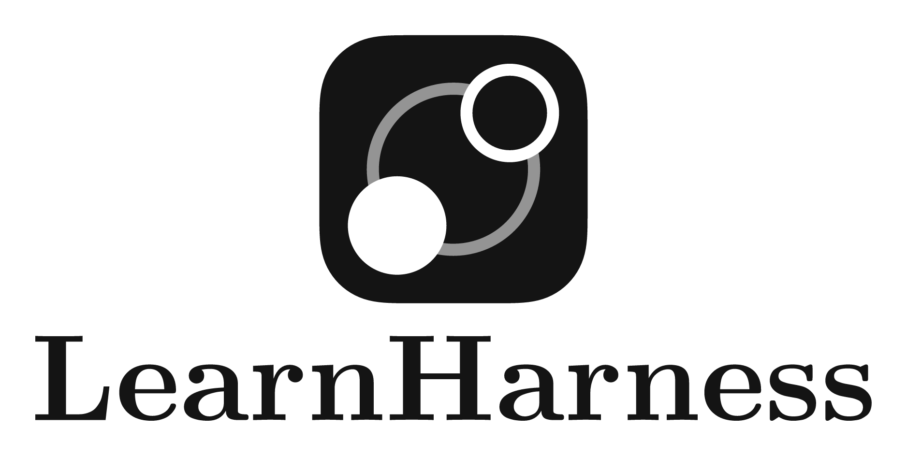
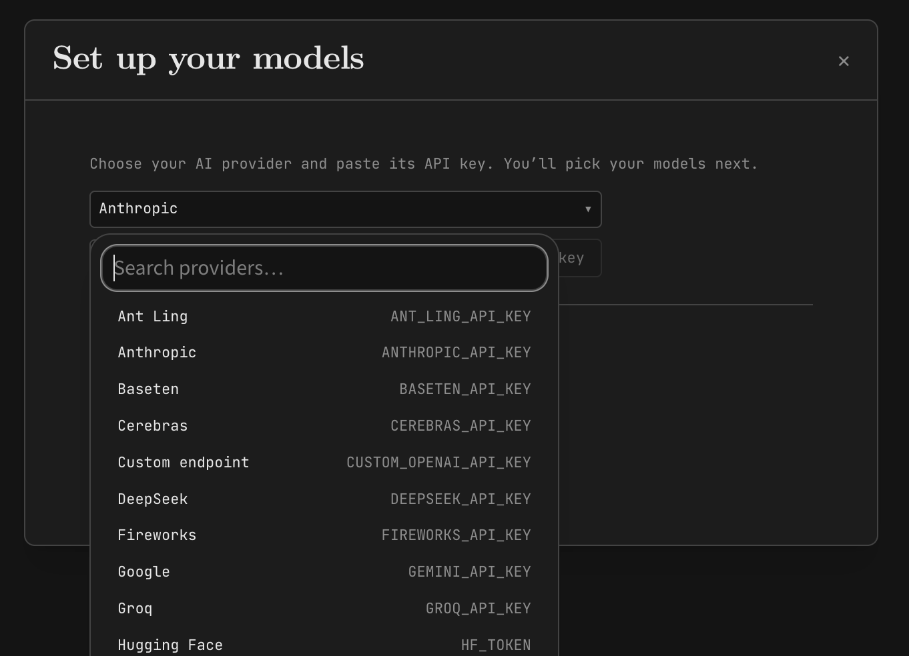
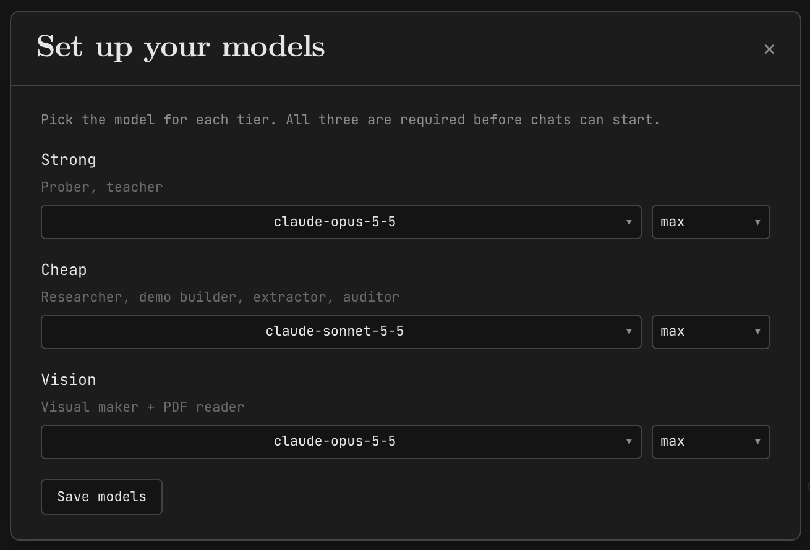
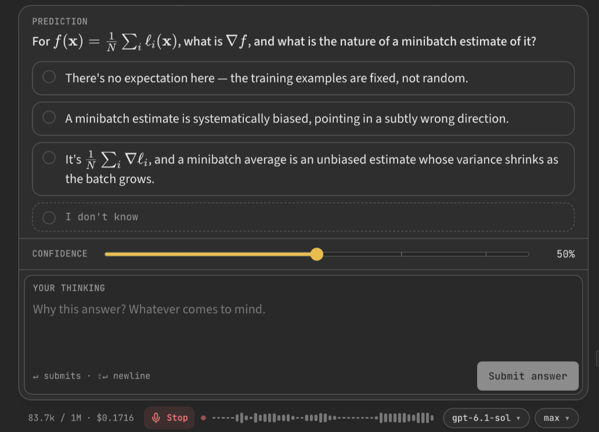
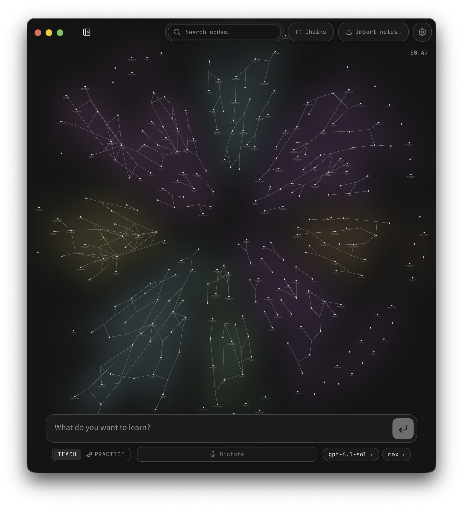

# LearnHarness Setup and Usage

> Follow [@operatoros](https://instagram.com/operatoros) and [@davis.mcm](https://instagram.com/davis.mcm) on Instagram for more guides like this.

### From download to a knowledge graph of what you actually understand.

LearnHarness is a free, open source desktop app built by Eero Alvar ([github.com/amosblomqvist/learnharness](https://github.com/amosblomqvist/learnharness)). You connect your own model, tell it what you want to learn, and it teaches you one verified step at a time. This guide takes you from install to a daily practice loop, with every menu path and command as the docs give them.

**What you'll get:**

→ Install on macOS, Windows, or Linux, and the four ways to connect a model
→ The mental model: three agents with separate instruction sets, and why that matters
→ Your first Teach session, step by step, and how to read the plan it draws
→ How the knowledge graph works, and how to feed it your own notes and PDFs
→ Six real use cases with the exact prompts to type
→ Cost levers, a troubleshooting table, and a backup script for your graph

> [!IMPORTANT]
> **Prerequisites:**
> 1. A Mac (Apple Silicon), Windows x64, or Linux x64 machine
> 2. One of: a model provider API key, a ChatGPT / GitHub Copilot / Grok subscription, an installed Claude Code CLI (version 2.1.259 or newer), or a local model server with an OpenAI-compatible endpoint
> 3. Nothing else. No account with LearnHarness itself, no subscription, no markup.

---

## Table of Contents

1. [What LearnHarness is](#1-what-learnharness-is)
2. [Install](#2-install)
3. [Connect a model](#3-connect-a-model)
4. [Pick your model slots](#4-pick-your-model-slots)
5. [The mental model](#5-the-mental-model)
6. [Your first Teach session](#6-your-first-teach-session)
7. [The knowledge graph](#7-the-knowledge-graph)
8. [Feed it your own notes and PDFs](#8-feed-it-your-own-notes-and-pdfs)
9. [Practice mode](#9-practice-mode)
10. [The playbook: six use cases](#10-the-playbook-six-use-cases)
11. [Cost control](#11-cost-control)
12. [Customize the prompts](#12-customize-the-prompts)
13. [Back up your graph](#13-back-up-your-graph)
14. [Troubleshooting](#14-troubleshooting)
15. [Limitations](#15-limitations)
16. [Quick reference](#16-quick-reference)
17. [Sources](#17-sources)

---

## 1. What LearnHarness is

Most AI use is answer retrieval. You ask, it answers, you move on, and a week later you remember none of it.

LearnHarness is built against that. It is a harness around the model with one job: get real understanding into your head and keep a record of it. It measures what you already know, plans a path from there to the thing you want to learn, teaches in steps where you predict before it explains, and distills every session into a graph of propositions and reasoning chains you can read.

The repo's own framing of the loop: "You predict, get an explanation, and check your understanding."

Two things separate it from a chat window:

1. **The model does not freelance.** It runs as three agents with separate instruction sets and separate tool access. The agent teaching you literally does not have the tools to skip the measuring phase.
2. **The output is not a chat log.** It is a knowledge graph of what you were taught, with links back to the source sessions. Future sessions read it. Practice mode drills from it.

License is AGPL-3.0. The README's words: "The app is free and open forever."

---

## 2. Install

Download from [learnharness.ai](https://learnharness.ai) or the [GitHub releases page](https://github.com/amosblomqvist/learnharness/releases).

- **macOS (Apple Silicon):** signed and notarized DMG. Drag the app to Applications.
- **Windows (x64):** run the installer. It is currently unsigned, so expect a SmartScreen "unknown publisher" warning. That is documented by the project, not a sign of a bad download, but only install from the two official sources above.
- **Linux (x64):** make the AppImage executable and open it, or install the `.deb`.

In-app updates run on all three platforms under **Settings → General**.

Running from source instead:

```bash
git clone https://github.com/amosblomqvist/learnharness.git
cd learnharness
npm ci
npm run dev
# opens at http://localhost:3000
```

> [!NOTE]
> Only Apple Silicon is named for macOS. Intel Mac support is not stated in the docs.

---

## 3. Connect a model

First run shows a provider picker. Everything after that lives in **Settings → Providers**. Four connection types, pick one to start:



**Option A: Provider API key.** Paste a key from your model provider and pay that provider's rates directly. No LearnHarness markup.

**Option B: Subscription connection.** ChatGPT, GitHub Copilot, and Grok connect through their own sign-in flows and run on your existing account limits. The docs are explicit that these "do not silently fall back to API-key billing."

**Option C: Claude Code CLI.** If you already run Claude Code, LearnHarness can route through it.

1. Make sure the CLI is installed, authenticated, and on your PATH. Minimum version 2.1.259.
2. Enable **Settings → Providers → External CLI → Claude Code**. It is off by default.
3. If it does not appear, hit **Check again**.
4. Model choices are the aliases `opus`, `sonnet`, and `haiku`.

On Windows this needs a directly runnable `claude.exe`. A `claude.cmd` shim alone does not qualify.

**Option D: Custom OpenAI-compatible endpoint.** This is the local model route.

1. **Settings → Providers → + Add a provider → Custom endpoint**
2. Enter the full base URL, for example `http://localhost:11434/v1` for a local Ollama server. LearnHarness does not append `/v1` for you.
3. Pick **Keyless** or **API key**. The env var `CUSTOM_OPENAI_API_KEY` overrides a saved value.
4. If your server has no model discovery, type the model IDs in manually.
5. Click **Connect**.

LearnHarness does not install or download models. Your server runs them, it just talks to them.

> [!TIP]
> **Pro tip:** Option D is the autonomy play. A local model server means the whole loop, teaching, graph, and practice, runs against hardware you own. No usage limits, no pricing changes, nothing to get cut off from.

---

## 4. Pick your model slots

There are no factory model selections. Before your first session, open Settings and assign three slots:



- **Strong:** the model new sessions start with. Your best reasoning model goes here.
- **Cheap:** a lighter model for lighter work.
- **Vision:** a model that reads images.

If a session will not start, empty slots are the first thing to check.

---

## 5. The mental model

LearnHarness is not one prompt. It is three agents taking turns over one shared conversation history, and the app decides who holds the microphone.

```
                    one shared session history
  ┌─────────────────────────────────────────────────────────┐
  │                                                         │
  │   PROBER                TEACHER              PRACTITIONER
  │   measures you          teaches the plan     drills you
  │                                                         │
  │   tools:                tools:               tools:
  │   probe / recall        quiz / explain       problem
  │   ask_user_question     ask_user_question    conclude
  │   probe_done            plan_init                       │
  │                                                         │
  └─────────────────────────────────────────────────────────┘
        │                      │
        └── probe_done ────────┘
            hands the session from prober to teacher

  every session ──distills──▶  knowledge graph (nodes, chains,
                               sessions, coverage)
                               read by: prober and practice
                               not read by: the teacher
```

The part worth understanding: each agent has its own composed system prompt AND its own tool registry. The prober cannot teach because it has no teaching tools. The teacher cannot skip ahead because the session only reaches it after a successful `probe_done` call. The plan itself is a validated Mermaid DAG, replaceable through `plan_init`, not a vibe.

The user-facing names for the phases are **Measure, Plan, Teach, Practice**.

And the system prompts are not a secret. The README states: "System prompts are visible and editable." Section 12 covers how.

---

## 6. Your first Teach session

1. Choose **Teach** and describe what you want to understand. Plain language, as specific as you can be.
2. The prober asks quick questions to find the edge of what you already know. Answer honestly. There is a thinking field and a confidence slider on probe questions. The docs' guidance: "Use the thinking fields to explain your reasoning, uncertainty, or reaction."
3. It draws a plan from your edge to the goal. Reply naturally to accept it or revise it.
4. Teaching runs in steps. You predict, it explains, it checks. Say when something is fuzzy. The whole design assumes honest signals.

What a probe looks like in a real session, with the "I don't know" option, the confidence slider, the thinking field, and the live token meter:



> [!TIP]
> **Pro tip:** Do not perform competence at the prober. If you inflate what you know, the plan starts past your real edge and every later step is built on the gap the app exists to prevent. Confidence is self-reported, and the system takes you at your word.

---

## 7. The knowledge graph

Every session distills into a graph. What it stores, in the repo's words: propositions and reasoning chains, "individual claims and the premises that lead to them," with links back to the source sessions. And explicitly: "It stores the ideas and their connections, not ratings of your ability."



That is the difference from the knowledge graphs flooding your feed. Those are knowledge bases built for an AI agent to read and act on. This one is a map of what you have actually been taught, growing in parallel while you learn. A second brain where the brain is yours.

Mechanics worth knowing:

- Graph construction runs after the fact, independent of the lesson plan: an extractor, an identity audit, a deterministic merge.
- Only teacher prose counts as source material. Your own answers do not get written in as facts.
- Future teaching sessions can read the graph instead of starting from scratch. Practice sessions draw material from it. The teacher agent itself has no graph-reader tools.
- On disk it is plain JSONL: `graph/nodes.jsonl`, `graph/chains.jsonl`, `graph/sessions.jsonl`, `graph/coverage.jsonl`. Yours, inspectable, portable.

---

## 8. Feed it your own notes and PDFs

The graph is not limited to what LearnHarness taught you. You can import what you already have:

1. Open the graph view.
2. **Extract files… → Files** or **Folder**.
3. Drop in Markdown, plain text, or PDFs.

Limits as documented: 25 MiB per file, up to three files in flight, and the queue does not survive a page reload. PDF conversion is local text extraction, not OCR, so image-only pages get skipped.

> [!NOTE]
> Imported text runs through model-based extraction, so imports cost tokens and are not an offline operation.

---

## 9. Practice mode

Choose **Practice** for problems instead of a lesson. Two ways to start:

- Pick material from your graph (there is a node picker), and it drills what is actually in there, aimed at your weak coverage.
- Or describe material directly and practice without the graph.

Work the problem, then hit **Next problem** to keep going. Practice outcomes count as session evidence, not graph rewrites, so your graph stays a record of ideas, not a scoreboard.

---

## 10. The playbook: six use cases

### Use Case 1: Learn something from zero

**Scenario:** You keep nodding along when auth comes up and you want it to actually make sense.

**The prompt (Teach):**

```
I want to understand how web authentication actually works: sessions,
cookies, JWTs, and OAuth. I can build a login form with a tutorial but
I could not explain what happens after the password is submitted.
```

**What happens:**
- The prober finds out you know HTTP basics but not state management
- The plan starts at cookies, not at OAuth
- Each step asks you to predict before it explains

**Expected outcome:** a plan you can see, and a first session that starts exactly where your knowledge stops.

> **Pro tip:** Put your honest ceiling in the prompt itself, like the last sentence above. It gives the prober a head start.

### Use Case 2: Fill the gaps in something you half-know

**Scenario:** You use a tool daily but learned it by pattern-matching, and the gaps show up in every hard debugging session.

**The prompt (Teach):**

```
I write React every day but I have never learned how rendering and
reconciliation actually work. Find what I am missing and fill the gaps.
```

**What happens:**
- The probe runs longer here, because the edge is jagged
- The plan skips what you genuinely know
- Teaching targets the specific holes

**Expected outcome:** a short path through only the missing pieces, instead of a React course you already half know.

> **Pro tip:** This is where LearnHarness beats a chatbot hardest. A chat answers the question you asked. The prober finds the questions you did not know to ask.

### Use Case 3: Turn your notes into a practice source

**Scenario:** You have a folder of Markdown notes or a PDF you highlighted once and never opened again.

**The steps:**

```
Graph view → Extract files… → Folder → select your notes folder
```

**What happens:**
- Extraction pulls propositions and reasoning chains out of your notes
- They land in the same graph as your sessions
- Practice mode can now drill them

**Expected outcome:** dead notes become a live question bank.

> **Pro tip:** Text-based PDFs only. There is no OCR, so a scanned book comes in as skipped pages.

### Use Case 4: Prep for an interview or a cert

**Scenario:** Two weeks out from a technical interview, and rereading notes is doing nothing.

**The prompt (Practice, after a few Teach sessions or an import):**

```
Drill me on system design fundamentals from my graph. Prioritize
whatever I have the weakest coverage on.
```

**What happens:**
- Practice pulls from graph material through the node picker
- Problems aim at thin coverage
- Each problem ends with a check, then Next problem

**Expected outcome:** a drill loop built from your actual record instead of a generic question list.

> **Pro tip:** Retrieval with feedback is the point of this mode. Reading feels like progress. Being made to answer is progress.

### Use Case 5: Learn a tool before you adopt it

**Scenario:** You are about to move your stack to Postgres and you do not want to learn indexing during an outage.

**The prompt (Teach):**

```
Teach me Postgres indexing well enough to design the indexes for a
multi-tenant SaaS. I know basic SQL. I have never read a query plan.
```

**What happens:**
- The plan bridges from basic SQL to reading EXPLAIN output
- You predict how queries behave before it shows you
- The reasoning chains land in your graph for later practice

**Expected outcome:** you walk into the migration with the mental model already built, on record.

> **Pro tip:** Run this a week before the real work, then one Practice session the day before. Spacing is free and it works.

### Use Case 6: The daily twenty minutes

**Scenario:** You want a standing learning habit that compounds instead of a tab graveyard.

**The loop:**

```
Day 1       Teach: one topic, honestly probed
Day 2-4     Teach: next steps of the plan
Day 5       Practice: drill the week's graph material
Ongoing     Practice whenever, Teach when something new matters
```

**What happens:**
- The graph accumulates across sessions
- Practice keeps hitting the thin spots
- Future Teach sessions read the graph instead of re-probing from zero

**Expected outcome:** a compounding record of understanding instead of fifty forgotten chats.

> **Pro tip:** The filled-in version of this loop is in [templates/first-sessions-plan.md](templates/first-sessions-plan.md). Copy it, fill the blanks, run the week.

---

## 11. Cost control

You bring the model, so you control the bill. The levers, strongest first:

1. **Run local.** A custom endpoint to your own model server costs you electricity. Note the defaults: context and output fall back to 8192 and 4096 tokens on custom endpoints unless you pin them higher.
2. **Ride a subscription you already pay for.** ChatGPT, Copilot, or Grok sign-in runs on those account limits. Claude Code CLI routing bills through your existing Claude setup (the app labels it "CLI billing").
3. **Set the Cheap slot deliberately.** Three model slots exist so everything does not run on your most expensive model.
4. **Turn on prompt caching for API keys on Anthropic routes.** **Settings → Agent → Models → Show advanced settings**, Cache dropdown per slot. Short maps to 5 minutes, Long to 1 hour. Cache writes cost 1.25x and 2x input respectively, so caching pays when sessions are long, which teaching sessions are.
5. **Watch the meter.** Click the context and cost row under the composer for session stats. Dollar figures are estimates of known API costs. Subscription, CLI, and custom-endpoint usage show as unpriced, not free.

The docs give no "expect N tokens per lesson" figure, so budget by watching your own first sessions.

**Best practices:**

1. One topic per Teach session. The probe and plan are per-session work, so let them pay off.
2. Answer the probe honestly. Wrong edge means wasted teaching steps, which is wasted money and time.
3. Import notes in batches you care about, not your whole vault at once. Extraction costs tokens per file.
4. Run Practice from graph material instead of described material once your graph has depth. It targets thin coverage instead of guessing.

---

## 12. Customize the prompts

The system prompts are visible and editable. This is rare and worth using once you know your own learning style.

How overrides work:

- Override files mirror the prompt segments under your data directory's `prompts/` folder: `system-prompt.md`, `prober/<fragment>.md`, `teacher/<fragment>.md`, `practice/<fragment>.md`, `shared/<fragment>.md`.
- Two conditions, both required: the matching switch in `settings.json` under `agent.prompts` is on, AND the file is readable. File presence alone does nothing.
- There is a settings UI for this. Changes apply to new sessions, not a running one.

> [!WARNING]
> **Warning:** An enabled empty override contributes nothing. There is no fallback to the original text, so you can silently blank out a piece of the instruction set. Read the original before you replace it.

---

## 13. Back up your graph

Everything lives on your machine in plain files:

- macOS: `~/Library/Application Support/LearnHarness/data`
- Windows: `%APPDATA%\LearnHarness\data`
- Linux: `$XDG_CONFIG_HOME/LearnHarness/data` or `~/.config/LearnHarness/data`

Inside: `chats/`, `jobs/`, `graph/`, `settings.json`, `prompts/`. API key files sit beside the data folder, not inside it, stored plaintext with restrictive file permissions.

[scripts/backup-graph.sh](scripts/backup-graph.sh) archives the data folder to a timestamped tarball on macOS and Linux. Keys are not included, by design.

```bash
chmod +x backup-graph.sh
./backup-graph.sh                 # backs up to ~/learnharness-backups
./backup-graph.sh /your/path      # or anywhere you want
```

---

## 14. Troubleshooting

| Problem | Cause | Fix |
|---|---|---|
| Windows warns "unknown publisher" | Installer is currently unsigned | Documented by the project. Only proceed if you downloaded from learnharness.ai or GitHub Releases |
| Session will not start | No models assigned | Set Strong, Cheap, and Vision in Settings. There are no factory selections |
| Claude Code option missing or dead | CLI not on PATH, too old, or Windows shim | Needs version 2.1.259+, discoverable on PATH, a real `claude.exe` on Windows. Hit Check again after fixing |
| Custom endpoint will not connect | Base URL missing `/v1` | Enter the full URL, like `http://localhost:11434/v1`. The app does not append it |
| No models listed on custom endpoint | Server has no discovery | Type the model IDs manually, then Connect |
| PDF import comes up empty | Image-only PDF, no OCR | Use text-based PDFs, or convert with OCR first |
| Import queue vanished | Queue does not survive a page reload | Re-add the files, keep batches to three in flight |
| Local model sessions feel cut short | Context and output default to 8192 and 4096 | Pin higher limits for the endpoint |

---

## 15. Limitations

Honest constraints, so you know what you are getting:

1. **Local storage is not local-only processing.** Your data sits on your machine, but every session sends content to whatever provider you configured. Fully private operation requires the local-endpoint route.
2. **API keys are stored plaintext** beside the data folder, with restrictive file permissions but no encryption.
3. **The graph records teaching, not mastery.** A node in your graph means you were taught it with sound provenance, not that you will remember it next month. Practice exists for a reason.
4. **No OCR.** Scanned PDFs and image-only pages do not import.
5. **File tools have broad read access** under your user account, with a guard that blocks known credential locations only. Treat attached files as content that goes to your provider.
6. **The Windows build is unsigned** today, and macOS support is Apple Silicon only as documented.

---

## 16. Quick reference

**Install:** [learnharness.ai](https://learnharness.ai) or [GitHub Releases](https://github.com/amosblomqvist/learnharness/releases)

**Menu paths:**

| What | Where |
|---|---|
| Updates | Settings → General |
| Model connections | Settings → Providers |
| Claude Code routing | Settings → Providers → External CLI → Claude Code |
| Custom endpoint | Settings → Providers → + Add a provider → Custom endpoint |
| Web search keys | Settings → Providers → Search (Tavily, Brave, Exa, Firecrawl, hosted Ollama) |
| Dictation | Settings → Providers → Dictation (Deepgram key, Member role or higher) |
| Prompt caching | Settings → Agent → Models → Show advanced settings |
| Session cost stats | Click the context and cost row under the composer |

**Shortcuts:** Mod+D starts dictation, Esc cancels and discards the transcript.

**Data locations:**

| Platform | Path |
|---|---|
| macOS | `~/Library/Application Support/LearnHarness/data` |
| Windows | `%APPDATA%\LearnHarness\data` |
| Linux | `$XDG_CONFIG_HOME/LearnHarness/data` or `~/.config/LearnHarness/data` |
| From source | `LH_DATA_DIR`, default `data/` in the repo |

**The loop:** Teach (probe, plan, predict, explain, check) → graph grows → Practice drills the thin spots.

---

## 17. Sources

- [LearnHarness repo](https://github.com/amosblomqvist/learnharness), README and docs read 2026-11-04: `docs/getting-started.md`, `docs/architecture.md`, `docs/custom-providers.md`, `docs/claude-code.md`, `src/agent/prompts/README.md`
- [Eero Alvar, "Agent Harness for Learning Things"](https://www.youtube.com/watch?v=nfTDljFG2g0), the creator's own walkthrough

---

Built by OperatorOS | [operatoros.ai](https://operatoros.ai)
Follow [@operatoros](https://instagram.com/operatoros) for production-grade AI guides.
App credited to Eero Alvar, its creator.
