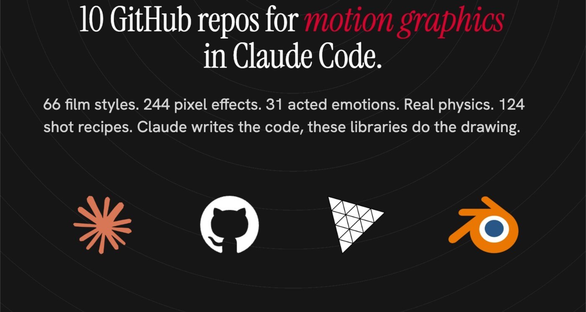
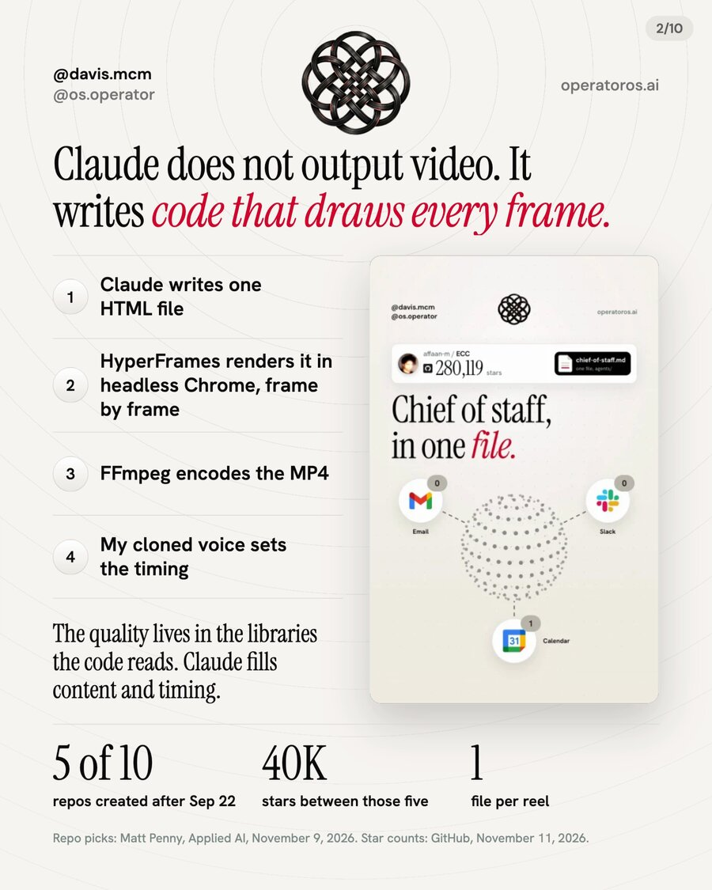
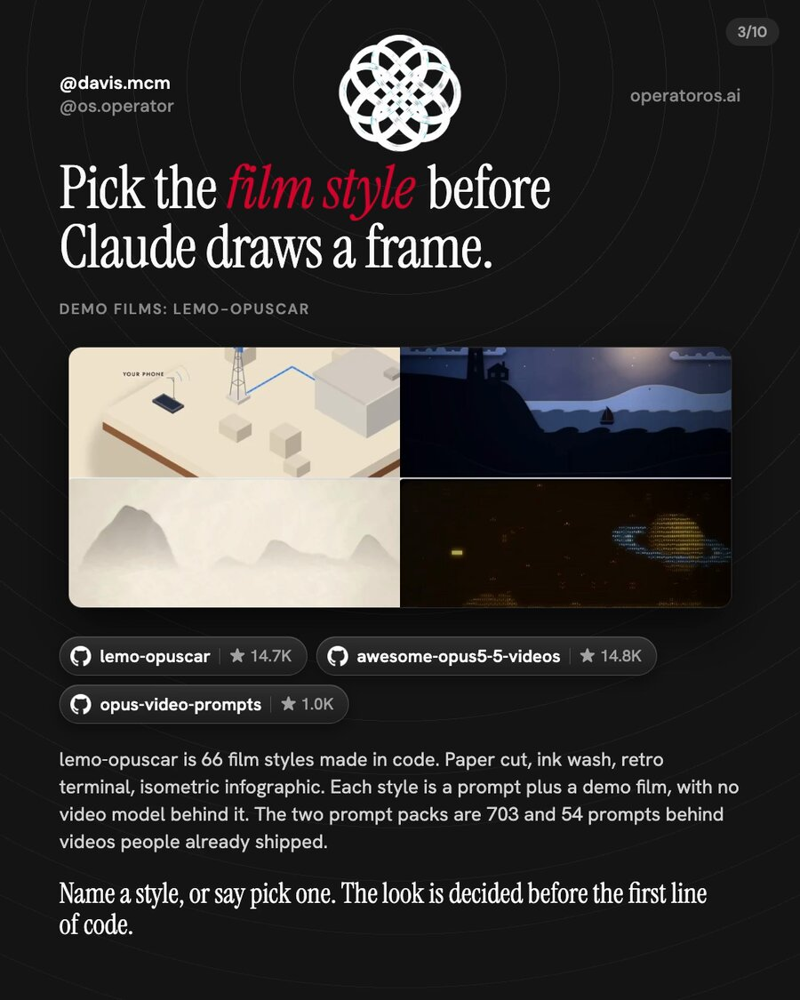
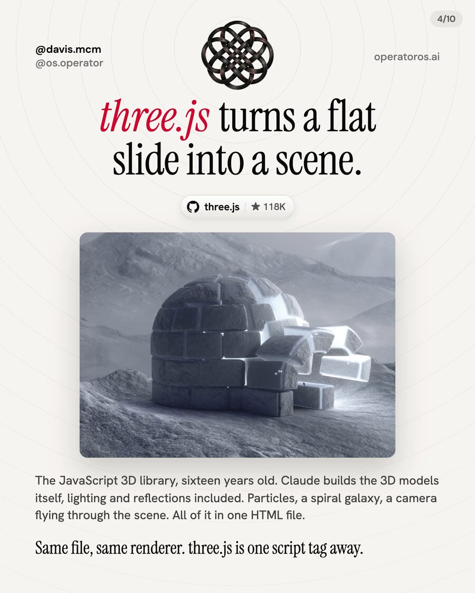
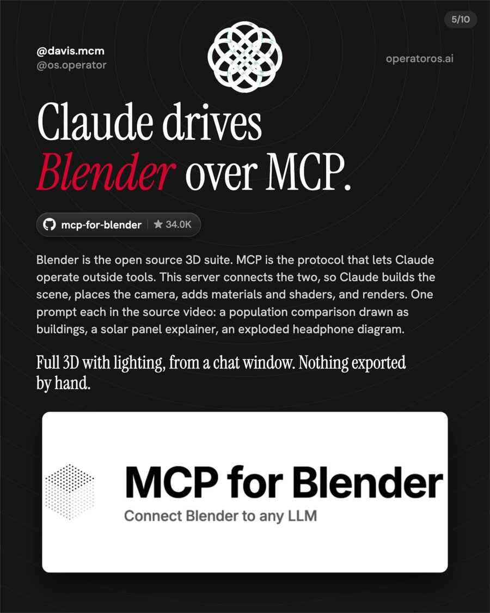
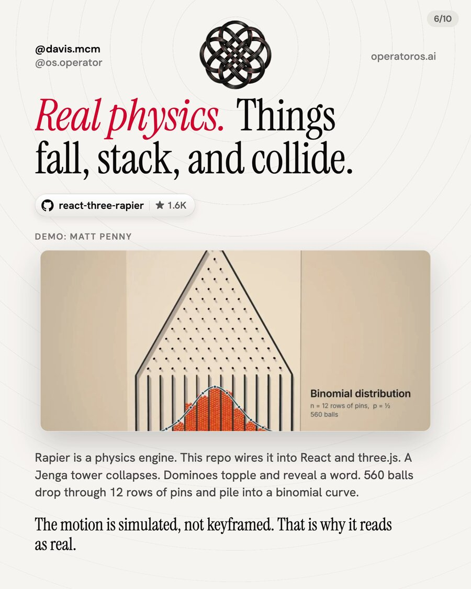
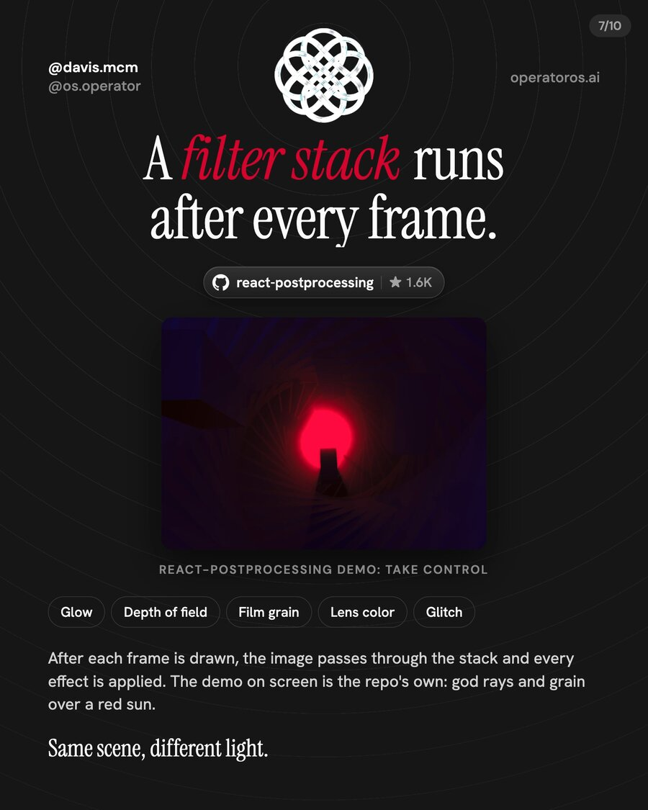
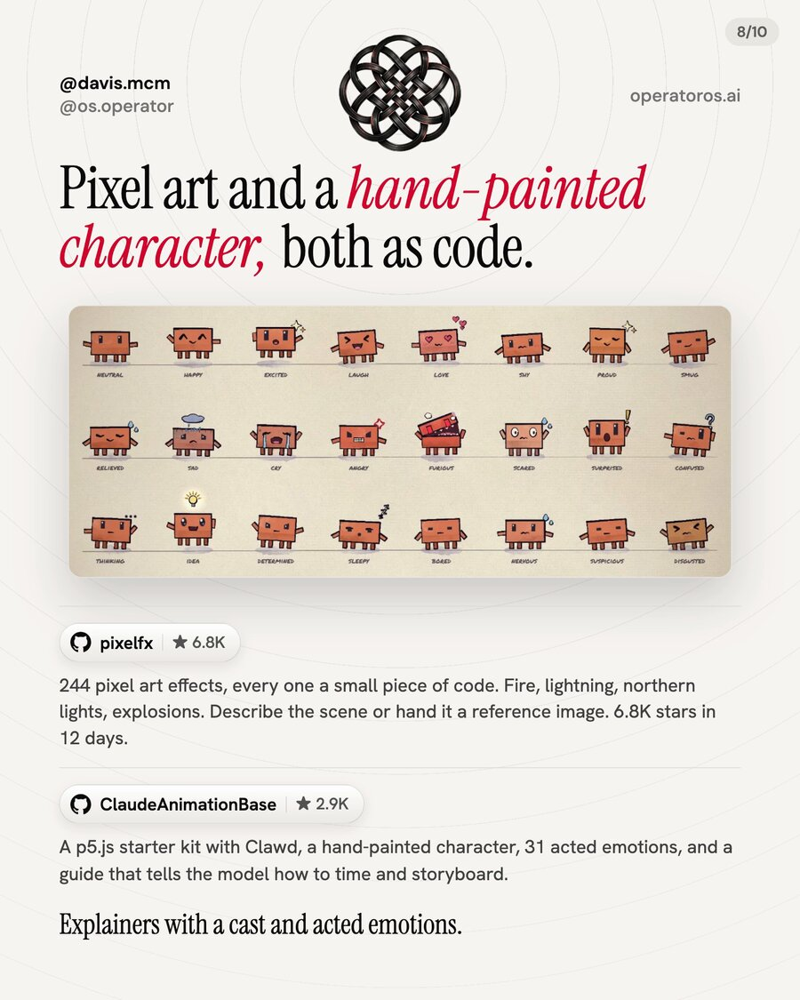
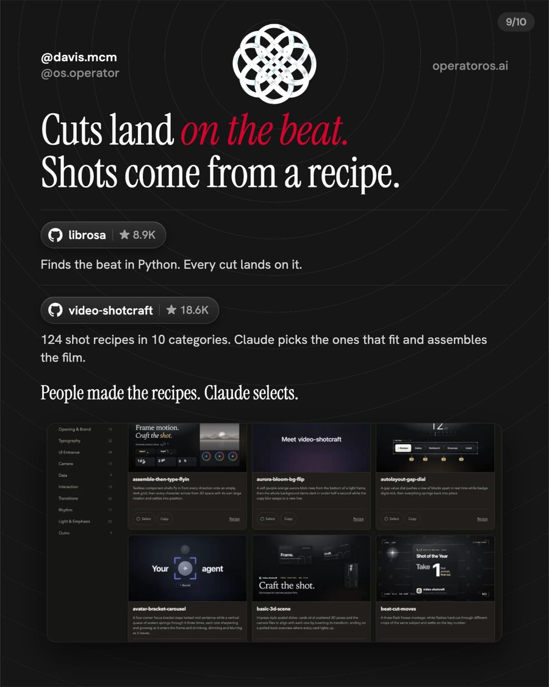
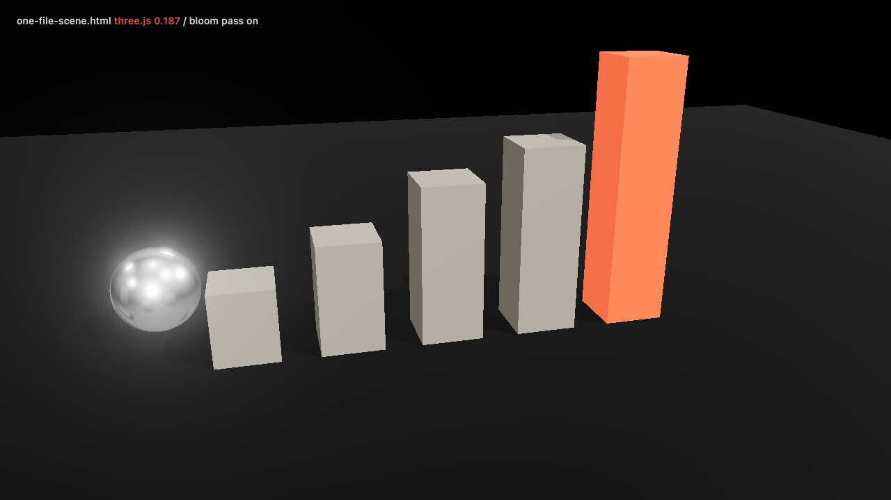

<p align="center">
  
</p>

# Motion Graphics Repos for Claude Code

> Follow [@davis.mcm](https://instagram.com/davis.mcm) and [@os.operator](https://instagram.com/os.operator) on Instagram for more guides like this.

---

### Ten GitHub repos that do the drawing when Claude Code makes a video. What each one adds, the install, and the one-line prompt that hands it to Claude.

Claude does not output video. It writes code that draws every frame, a headless browser captures the frames, and FFmpeg encodes the MP4. Every animated reel on my account is made that way: one HTML file, rendered frame by frame.

That means the quality of the picture lives in the libraries the code imports, not in the model. Claude fills in content and timing. The ten repos below are the libraries. Matt Penny of Applied AI put the list together in his video, linked in Sources. This guide is the same ten through the pipeline I already run, with the install and the prompt for each one.

---

## What you'll get

→ All ten repos with links, star counts, licenses, and what each one adds to a frame

→ The install for each, verified against its README on 2026-11-11

→ The one-line prompt that hands each repo to Claude, in [`templates/prompts.md`](templates/prompts.md)

→ [`templates/one-file-scene.html`](templates/one-file-scene.html): a three.js scene with reflections, shadows, and a bloom pass in one file that renders as is

→ [`scripts/install.sh`](scripts/install.sh): installs the Claude Code plugins, the Blender MCP server, and the two cloned repos in one run

→ Where each repo sits in the pipeline, so you know which one to reach for

---

## Contents

1. [How a reel gets made](#1-how-a-reel-gets-made)
2. [The ten repos](#2-the-ten-repos)
3. [Where each one sits](#3-where-each-one-sits)
4. [The starter file](#4-the-starter-file)
5. [The install script](#5-the-install-script)
6. [Pro tips](#6-pro-tips)
7. [Quick reference](#7-quick-reference)
8. [Sources](#8-sources)

---

## 1. How a reel gets made

<p align="center"></p>

Four steps, every time.

1. Claude writes one HTML file. CSS at the top, scenes as sections, one timeline at the bottom.
2. A frame renderer opens the file in headless Chrome and captures it frame by frame. I use HyperFrames by HeyGen.
3. FFmpeg encodes the frames into an MP4.
4. A voice track with word-level timestamps sets the timing, so every visual lands on its word.

The full workflow, with the scripts and a starter reel, is in [guides/claude-code-reels](../claude-code-reels/). This guide is about what you import into step 1.

Five of the ten repos below did not exist on 2026-09-22. On 2026-11-11 they held 40,310 stars between them.

---

## 2. The ten repos

Star counts are from the GitHub API on 2026-11-11. Every install line is copied from the repo's own README on the same day. The prompts are in [`templates/prompts.md`](templates/prompts.md), one block each, ready to paste.

### lemo-opuscar

<p align="center"></p>

[github.com/lemomo-ai/lemo-opuscar](https://github.com/lemomo-ai/lemo-opuscar). 14,696 stars. Created 2026-09-26. MIT. By Lemomo.

Sixty-six film styles made in code, each one a style prompt plus a demo film drawn entirely by Claude Opus 5.5. Paper cut, ink wash, retro terminal, isometric infographic, watercolor, Swiss motion graphics. You name the style and the subject, the plugin reads three guides (how to direct, how to build, what the style looks like) and works through storyboard, frames, voice, music, and mix. You can also change a library style into your own and keep it in `~/lemo-my-styles/`. The same repo holds OPUSCAR 98, a six-minute film that redraws all 98 Best Picture winners, each in a style that fits, with the 98 style prompts open.

Needs Node 20 or newer, FFmpeg 7 or newer, and Python 3.11 or newer (or uv). A film takes the agent 30 to 60 minutes.

```bash
claude plugin marketplace add lemomo-ai/lemo-opuscar
claude plugin install lemo-opuscar@lemolab
```

```text
Make a 40-second film in the isometric infographic style about [how my product works]. Calm male narrator. Show me the storyboard first.
```

### awesome-opus5-5-videos

[github.com/yihui-dev/awesome-opus5-5-videos](https://github.com/yihui-dev/awesome-opus5-5-videos). 14,825 stars. Created 2026-09-27. MIT.

703 prompts behind videos people posted after making them with Claude Opus 5.5, 418 of them with a live remake you can watch beside the original on Skillry. Every entry links to the creator's post. The use is three steps the README spells out: open a prompt file, copy the block under Prompt, paste it into Claude and ask for a single HTML file.

A second pack worth knowing: [github.com/joeseesun/opus-video-prompts](https://github.com/joeseesun/opus-video-prompts), 1,043 stars, created 2026-09-27, 54 public cases with 18 complete prompts, in Chinese. Its README states the pipeline in one paragraph: Opus does not output video files, it writes code that draws each frame (Canvas, p5.js, three.js, Manim, Blender scripts), a headless browser captures them, FFmpeg composes the MP4.

No install.

```text
Render this as a single HTML file in this folder, every frame drawn by code, no video model. When it is done, tell me how to record it.

[paste the prompt block here]
```

### three.js

<p align="center"></p>

[github.com/mrdoob/three.js](https://github.com/mrdoob/three.js). 118,131 stars. Created 2010-03-23. MIT.

The JavaScript 3D library. Cameras, lights, materials, shadows, environment maps for reflections, a postprocessing chain of its own in `examples/jsm/postprocessing`. In a single HTML file it is one import map pointing at a CDN, no build step. That is how the starter file in this folder loads it. Claude can build the models in code, light them, and fly a camera through the scene, and the whole thing stays one file next to the rest of your reel.

No install for a single HTML file. Pin the version in the import map:

```html
<script type="importmap">
{ "imports": {
  "three": "https://cdn.jsdelivr.net/npm/three@0.187.0/build/three.module.js",
  "three/addons/": "https://cdn.jsdelivr.net/npm/three@0.187.0/examples/jsm/"
} }
</script>
```

```text
Read one-file-scene.html. Keep the import map, the bloom pass, and the ?t= frame control. Replace the bars with [a product shot of my app, floating in a dark studio, slow camera orbit]. Add a chrome ground plane so it reflects.
```

### mcp-for-blender

<p align="center"></p>

[github.com/ahujasid/mcp-for-blender](https://github.com/ahujasid/mcp-for-blender). 33,980 stars. Created 2025-03-07. MIT. By Siddharth Ahuja. A third-party integration, not made by Blender.

Blender is the open source 3D suite. MCP is the protocol that lets Claude operate outside tools. This server connects the two: Claude builds the scene, places the camera, adds materials and shaders, and renders, from the chat. The one-command setup installs uv if needed, finds the MCP clients on your machine, adds a `blender` entry to each one you pick, and installs and enables the Blender addon. The addon starts its server when Blender opens, so Blender is open before you ask.

```bash
claude mcp add blender uvx mcp-for-blender
uvx mcp-for-blender setup
```

Or the one-liner from the README on macOS and Linux: `curl -LsSf https://www.mcp-for-blender.com/install.sh | sh`. Install uv with its official installer, not pip. Then fully quit and reopen Claude Code.

```text
In Blender, build [a solar panel on a tilted roof], add materials and a three-point light rig, frame it with a 50mm camera, and render a 1920x1080 still to renders/panel.png.
```

### react-three-rapier

<p align="center"></p>

[github.com/pmndrs/react-three-rapier](https://github.com/pmndrs/react-three-rapier). 1,578 stars. MIT. By pmndrs.

Rapier is a physics engine compiled to WebAssembly. This repo wraps it for react-three-fiber: a `Physics` component, `RigidBody` around any mesh, colliders generated from the geometry or placed by hand, joints, collision events. Things fall, stack, and collide because the engine simulates them, not because someone keyframed them. In Matt's demos a Jenga tower collapses, dominoes topple to reveal a word, and 560 balls drop through 12 rows of pins into a bell curve. Version 2 targets fiber v9 and React 19.

```bash
npm install three @react-three/fiber @react-three/rapier
```

```text
Build a Galton board with @react-three/rapier: 12 rows of pins, 560 balls dropped one at a time, bins at the bottom. Label the bins with counts as the balls land. The result should settle into a bell curve on its own.
```

### react-postprocessing

<p align="center"></p>

[github.com/pmndrs/react-postprocessing](https://github.com/pmndrs/react-postprocessing). 1,556 stars. MIT. By pmndrs.

A filter stack that runs after every frame is drawn. You wrap your scene in an `EffectComposer` and list the effects: `Bloom`, `DepthOfField`, `Noise`, `Vignette`, glitch, color grading. The underlying postprocessing library merges every effect into one pass, so stacking five costs about the same as one. Two live demos ship in the README, Bubbles and Take Control, with their full code.

```bash
npm install @react-three/postprocessing
```

```text
Add an EffectComposer to this scene with Bloom, DepthOfField, Noise and Vignette. Keep every effect off by default and expose a flag for each, so I can turn them on one at a time and compare.
```

### pixelfx

<p align="center"></p>

[github.com/patch-gg/pixelfx](https://github.com/patch-gg/pixelfx). 6,871 stars. Created 2026-10-30. MIT. By Patch. The method is Hugo Duprez's, credited in the README.

244 pixel art effects, every one a small piece of code. Fire, explosions, lightning, weather, magic, UI, pickups, critters. No images anywhere: pure effects are a function of time, simulated ones step real particles at 120 Hz, and every random number comes from a seed so frame 40 is the same every time. Effects with a character are acted, with a wind-up, a freeze on contact, and a recovery. Use them in a browser game with the JavaScript module, or export sprite sheets for Godot, Unity, GameMaker and the rest. The Claude Code plugin teaches Claude to find, use, export and make new ones.

```bash
claude plugin marketplace add patch-gg/pixelfx
claude plugin install pixelfx@pixelfx
```

```text
Make a 12-second loop in pixelfx: a campfire at night with fireflies, light rain starting at second six, lightning at second nine. Render it as an MP4.
```

### ClaudeAnimationBase

[github.com/JohnHeibel/ClaudeAnimationBase](https://github.com/JohnHeibel/ClaudeAnimationBase). 2,875 stars. Created 2026-09-23. MIT. By John Heibel.

A starter kit for animating a hand-painted character in p5.js and p5.brush. The character is Clawd, with 31 acted emotions, several views, hats, and dances, drawn in brush strokes and boiling linework. `ANIMATION_GUIDE.md` holds the rules the model follows (handmade, alive, one piece, no text, something happens in every scene) and the timing principles. You clone it, open Claude Code inside, and ask for a video. The model storyboards, builds shot by shot, renders contact sheets to check itself, and writes `out/video.mp4`. Needs Node, Google Chrome, and FFmpeg.

```bash
git clone --depth=1 https://github.com/JohnHeibel/ClaudeAnimationBase.git
cd ClaudeAnimationBase && npm install && claude
```

```text
Read ANIMATION_GUIDE.md, then make a 15-second video of Clawd [explaining what a webhook is to a confused friend]. Storyboard first.
```

### librosa

[github.com/librosa/librosa](https://github.com/librosa/librosa). 8,875 stars. Created 2012-10-20. ISC.

Audio and music analysis in Python. The two calls that matter for motion graphics are `beat_track`, which returns the tempo and the time of every beat, and `onset_detect`, which returns every moment a sound starts. Write those times to a JSON file and the visuals snap to them, so every cut lands on the beat the way launch films do.

```bash
pip3 install librosa
```

```text
Write beats.py: load track.mp3 with librosa, run beat_track and onset_detect, and write beats.json with every beat time in seconds and the BPM. Then update index.html so every scene change lands on the nearest beat.
```

### video-shotcraft

<p align="center"></p>

[github.com/Vincentwei1021/video-shotcraft](https://github.com/Vincentwei1021/video-shotcraft). 18,633 stars. Created 2026-07-19. Apache 2.0. By Vincent Wei.

A skill for Claude Code and Codex that makes product promo videos: 124 shot recipe cards in 10 categories, 150 motion previews in the gallery, beat sync and sound design built in. You say "make a promo for my product." The agent captures your real pages, picks recipes that fit, storyboards the film, animates it, cuts it to the beat, checks every frame, and hands you an MP4 you can keep editing. People wrote the recipes. Claude selects. The repo animates with Remotion. In my own reels the renderer is HyperFrames, and the recipe library is the part worth reading either way.

```bash
git clone --depth=1 https://github.com/Vincentwei1021/video-shotcraft.git
ln -sfn "$(pwd)/video-shotcraft" ~/.claude/skills/video-shotcraft
```

The README's shortest path is one line in Claude Code: `Install this skill for me: https://github.com/Vincentwei1021/video-shotcraft`.

```text
Use video-shotcraft to make a promo for my product.
```

---

## 3. Where each one sits

Read this top to bottom and it is the order a piece gets made.

- **The look, before any code.** lemo-opuscar names the style. The two prompt packs show what a finished prompt looks like.
- **The scene.** three.js draws it. Blender over MCP when you want full 3D with materials and a real renderer, exported as stills or clips.
- **Inside the scene.** react-three-rapier moves the objects with physics instead of keyframes.
- **After every frame.** react-postprocessing applies the filter stack: glow, depth of field, grain, vignette.
- **Instead of 3D.** pixelfx for pixel art, ClaudeAnimationBase for a hand-painted character.
- **On the cut.** librosa finds the beat. video-shotcraft picks the shots.

A single reel rarely uses more than three of these. The point of knowing all ten is knowing which one to import for the frame in front of you.

---

## 4. The starter file

<p align="center"></p>

[`templates/one-file-scene.html`](templates/one-file-scene.html) is one HTML file, no build step, that renders a chart as a scene. Open it in Chrome and it animates. It has:

- An import map pinned to three.js 0.187.0 on the jsDelivr CDN
- Five bars that grow in one after another, with the last one emissive
- A chrome sphere, so the reflections have something to show on
- Shadows from a directional light and reflections from `RoomEnvironment`, three.js's built-in studio
- A filter stack: `RenderPass`, `UnrealBloomPass`, `OutputPass`
- A slow camera orbit
- A `?t=` control. Open `one-file-scene.html?t=2.5` and it draws that exact second and stops. That is how a frame renderer captures video from a page: it asks for every frame by time.

Everything on screen is a function of `t`. Change the numbers in `values`, change the colors, or hand the file to Claude with the three.js prompt above and let it replace the bars with your subject.

To capture frames yourself without a renderer, any headless browser works. HyperFrames does the loop and the FFmpeg encode for you, covered in [guides/claude-code-reels](../claude-code-reels/).

---

## 5. The install script

[`scripts/install.sh`](scripts/install.sh) runs the installs from section 2 that can run from a terminal. Each target is independent and safe to rerun.

```bash
bash scripts/install.sh --list all        # show every command, run nothing
bash scripts/install.sh lemo-opuscar pixelfx
bash scripts/install.sh blender           # needs uv
bash scripts/install.sh shotcraft clawd   # clones into ~/motion-repos, links shotcraft into ~/.claude/skills
bash scripts/install.sh librosa
bash scripts/install.sh all
```

The three React packages are printed, not installed, because they belong in a project of yours, not in your home folder.

---

## 6. Pro tips

> [!TIP]
> **Decide the style before the subject.** With lemo-opuscar the style prompt is loaded before the first line of code. Say "isometric infographic" or "ink wash" first, then the topic. If you say the topic first, you get the default look and spend the next hour correcting it.

> [!TIP]
> **Pin every version in the import map.** three.js ships a new minor most months and moves addon paths between them. `three@0.187.0` renders the same file the same way in a year. A bare `three` will not.

> [!TIP]
> **Make every animation a function of time.** The starter uses `draw(t)`. A frame renderer asks the page for second 2.5, then 2.517, then 2.533. Code that animates by `requestAnimationFrame` alone cannot answer that question, so it renders wrong at any frame rate but the one you tested.

> [!TIP]
> **Add effects one at a time.** Bloom plus depth of field plus grain plus vignette, all at once, looks like a filter preset. Turn each one on alone, look at a still, then stack. The prompt in section 2 asks Claude for a flag per effect for this reason.

> [!TIP]
> **Beat first, then cut.** Run librosa before you place a single scene change. Write the beat times to a file and have the timeline read them. Cutting by eye and then "fixing it to the music" takes longer than starting from the grid.

> [!TIP]
> **Open Blender before you ask.** The MCP addon starts its server when Blender starts. If Claude reports it cannot reach Blender, the app is closed or the addon is off in Preferences, nothing is wrong with the MCP entry.

---

## 7. Quick reference

```bash
# plugins (Claude Code)
claude plugin marketplace add lemomo-ai/lemo-opuscar && claude plugin install lemo-opuscar@lemolab
claude plugin marketplace add patch-gg/pixelfx && claude plugin install pixelfx@pixelfx

# MCP (needs uv from its official installer)
claude mcp add blender uvx mcp-for-blender && uvx mcp-for-blender setup

# skills and kits
git clone --depth=1 https://github.com/Vincentwei1021/video-shotcraft.git && ln -sfn "$(pwd)/video-shotcraft" ~/.claude/skills/video-shotcraft
git clone --depth=1 https://github.com/JohnHeibel/ClaudeAnimationBase.git && cd ClaudeAnimationBase && npm install

# python
pip3 install librosa

# react project
npm install three @react-three/fiber @react-three/rapier @react-three/postprocessing

# single HTML file
cp templates/one-file-scene.html ./scene.html && open scene.html
```

- Prompts, one per repo: [`templates/prompts.md`](templates/prompts.md)
- lemo-opuscar styles live in `~/lemo-opuscar`, your own in `~/lemo-my-styles/`
- pixelfx sprite sheets: `node tools/render.mjs ice/frost-nova --sheet` inside the repo
- ClaudeAnimationBase render: `node render.mjs --clip --out=out/video.mp4`
- video-shotcraft gallery: [vincentwei1021.github.io/video-shotcraft](https://vincentwei1021.github.io/video-shotcraft/)
- The frame renderer I use: HyperFrames by HeyGen, `npx -y hyperframes doctor` checks Node, FFmpeg, and Chrome

---

## 8. Sources

- Matt Penny, Applied AI, "10 GitHub Repos to 10x Your AI Motion Graphics," YouTube, 2026-11-09: [youtu.be/aD9X6Lc3dVk](https://youtu.be/aD9X6Lc3dVk). The list is his.
- Star counts and creation dates: GitHub API, 2026-11-11.
- lemo-opuscar README (66 styles, OPUSCAR 98, requirements, install): [github.com/lemomo-ai/lemo-opuscar](https://github.com/lemomo-ai/lemo-opuscar)
- awesome-opus5-5-videos README (703 prompts, 418 remakes, how to use): [github.com/yihui-dev/awesome-opus5-5-videos](https://github.com/yihui-dev/awesome-opus5-5-videos)
- opus-video-prompts README (54 cases, 18 prompts, the pipeline paragraph): [github.com/joeseesun/opus-video-prompts](https://github.com/joeseesun/opus-video-prompts)
- three.js README and examples: [github.com/mrdoob/three.js](https://github.com/mrdoob/three.js), [threejs.org/examples](https://threejs.org/examples/)
- mcp-for-blender README (quickstart, Claude Code setup, disclaimer): [github.com/ahujasid/mcp-for-blender](https://github.com/ahujasid/mcp-for-blender)
- react-three-rapier README: [github.com/pmndrs/react-three-rapier](https://github.com/pmndrs/react-three-rapier)
- react-postprocessing README and demos: [github.com/pmndrs/react-postprocessing](https://github.com/pmndrs/react-postprocessing)
- pixelfx README (244 effects, plugin install, how it works, credits): [github.com/patch-gg/pixelfx](https://github.com/patch-gg/pixelfx)
- ClaudeAnimationBase README: [github.com/JohnHeibel/ClaudeAnimationBase](https://github.com/JohnHeibel/ClaudeAnimationBase)
- librosa docs: [librosa.org/doc](https://librosa.org/doc/)
- video-shotcraft README and gallery: [github.com/Vincentwei1021/video-shotcraft](https://github.com/Vincentwei1021/video-shotcraft)
- HyperFrames by HeyGen: [github.com/heygen-com/hyperframes](https://github.com/heygen-com/hyperframes)

---

Built by OperatorOS | operatoros.ai

Follow [@os.operator](https://instagram.com/os.operator) for production-grade AI guides. Repo list by Matt Penny, Applied AI. Each repo belongs to its maintainer, named above.
