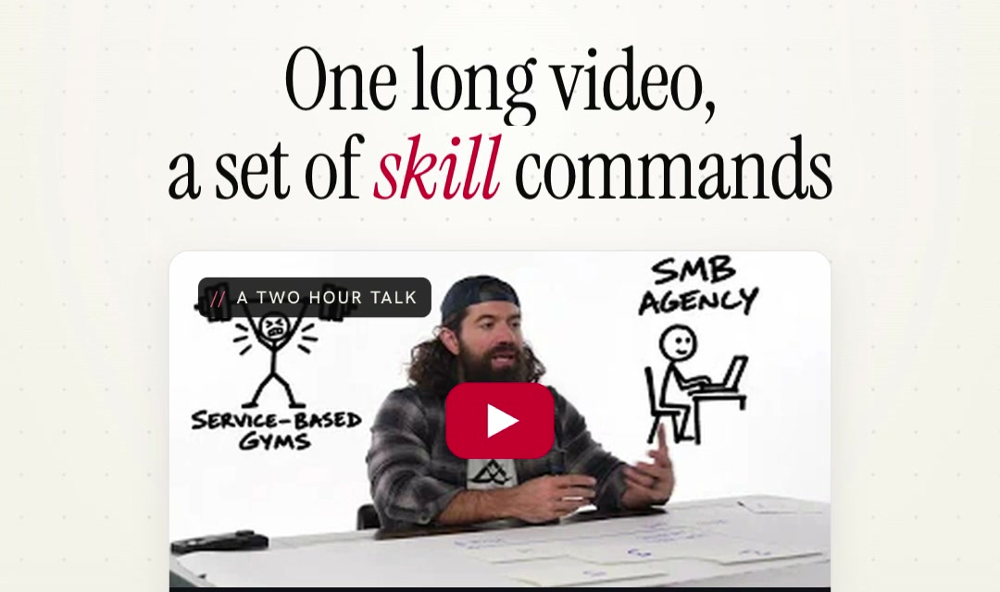
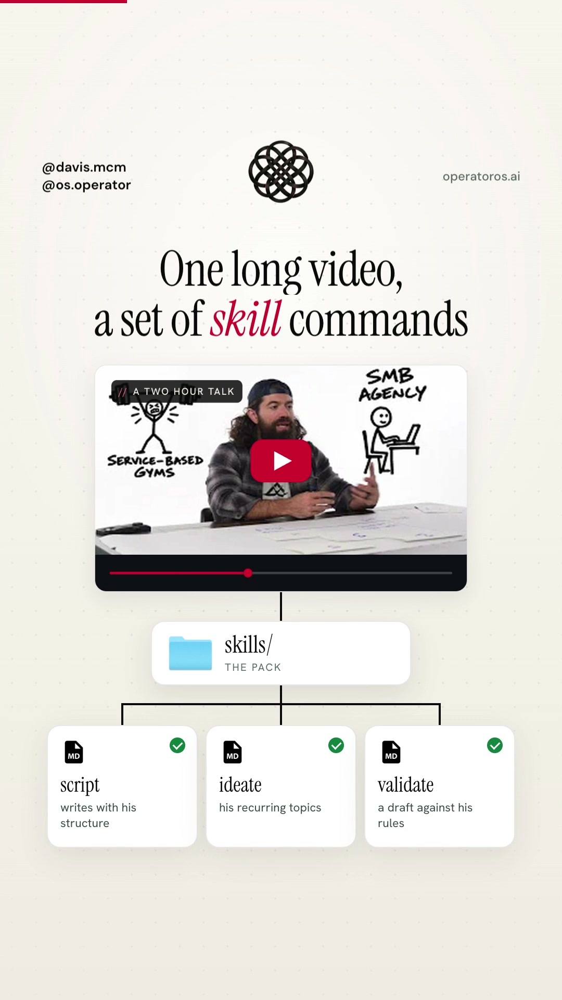
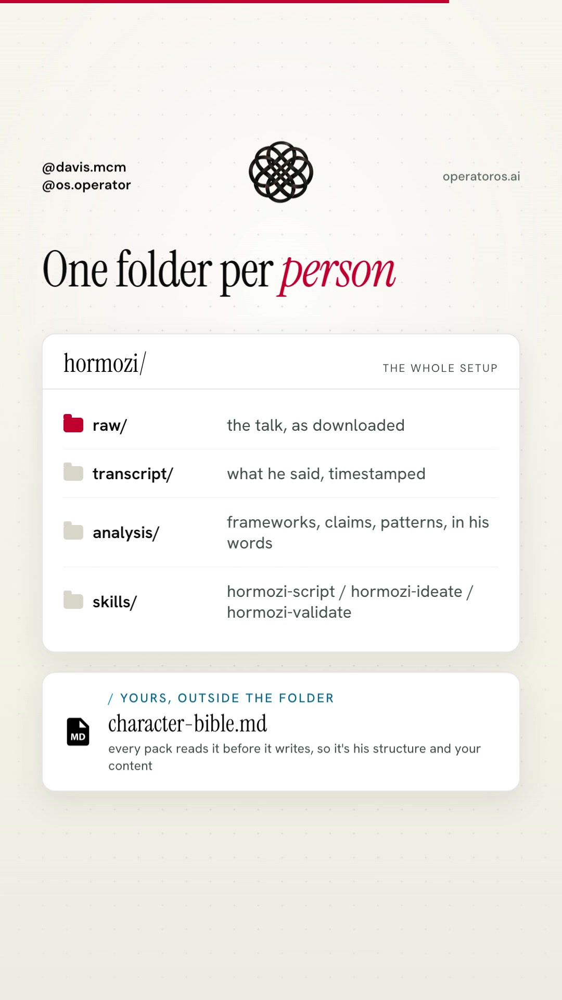
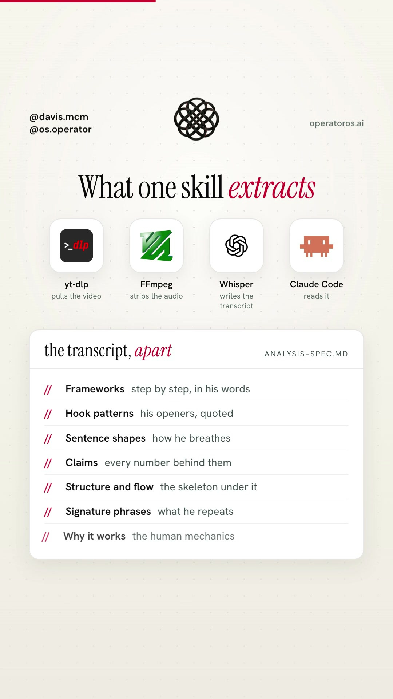
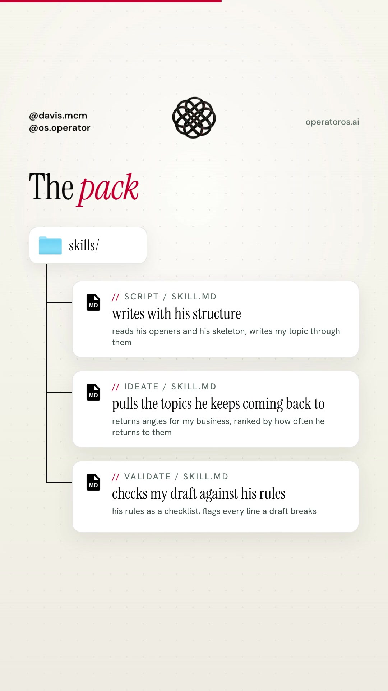
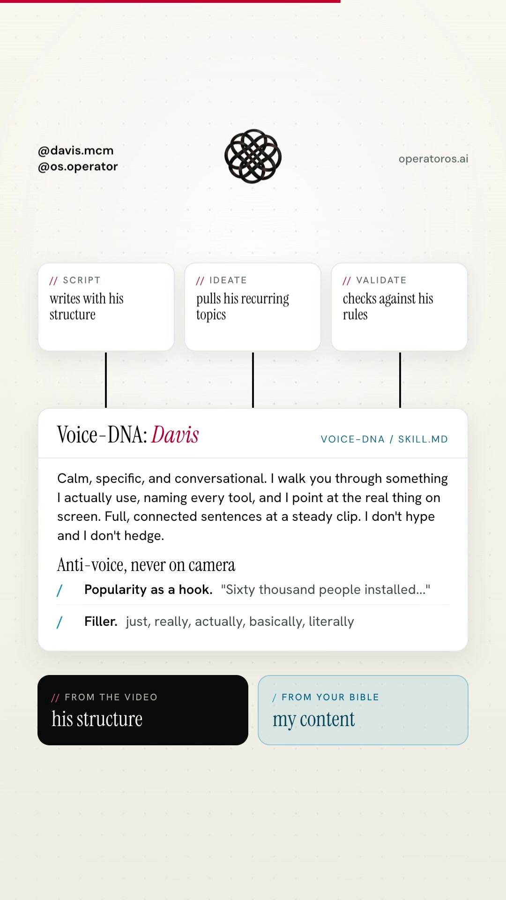
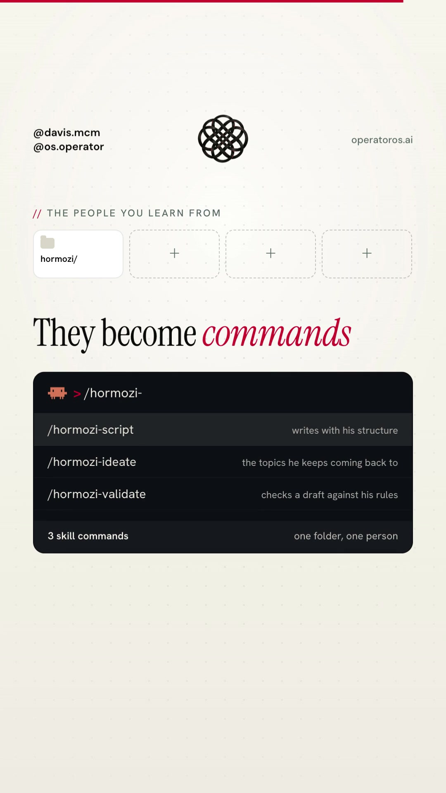

# Video to Skills

> Follow [@davis.mcm](https://instagram.com/davis.mcm) and [@os.operator](https://instagram.com/os.operator) on Instagram for more guides like this.

*From one long YouTube video to three Claude Code commands that put that person's practices to work on your own content, in your own voice.*

A summary is one page you read once. This is the other thing: a folder per person, an evidence-based analysis of how they teach, and a pack of three skills (script, ideate, validate) that read your own voice file before they write a word. The whole setup is in this folder. The analysis and the pack generator are one skill in the [skills library](../../skills/video-to-skills/).

## What you'll get

→ `pull.py`, one command that turns a YouTube URL into a person folder with a timestamped transcript (captions first, Whisper when there are none)

→ The `/video-to-skills` skill: reads the whole transcript, writes an eleven-section analysis where every claim carries a quote and a timestamp, then installs the pack

→ Three skill templates it fills: `<name>-script` (writes with their structure), `<name>-ideate` (their recurring topics mapped onto your business, ranked by how often they return to them), `<name>-validate` (a checklist of the rules they state, with the fix for every miss)

→ A `voice-dna` template for your own voice file, the layer that keeps the output yours

→ The one-folder-per-person layout, as a template you can copy by hand

→ Six real prompts, the cost of each transcript route from the vendors' own price pages, and a troubleshooting table

## Prerequisites

- **macOS or Linux** with a terminal. Windows works through WSL.
- **Python 3.10 or newer.** `pull.py` uses the standard library only, nothing to pip install.
- **yt-dlp, FFmpeg, and Deno.** `brew install yt-dlp ffmpeg deno` on macOS. All free. Current yt-dlp solves YouTube's download challenge with a JavaScript runtime, and Deno is the one it picked up in our test. Without it, metadata and captions still work but the media download returns a 403.
- **Claude Code.** The skill and the pack run inside it.
- **Optional, one API key** for videos with no captions: Groq (`GROQ_API_KEY`) or OpenAI (`OPENAI_API_KEY`). Most YouTube talks have captions, so start without one.

## Table of contents

1. [Foundations](#1-foundations)
2. [The mental model](#2-the-mental-model)
3. [Core concepts](#3-core-concepts)
4. [Step by step: your first person](#4-step-by-step-your-first-person)
5. [Practical playbook](#5-practical-playbook)
6. [Cost and best practices](#6-cost-and-best-practices)
7. [Troubleshooting](#7-troubleshooting)
8. [Quick reference](#8-quick-reference)
9. [Sources](#9-sources)

---

## 1. Foundations

### Install the tools

```bash
brew install yt-dlp ffmpeg deno
python3 --version
```

Any Python 3.10 or newer is fine. If `brew` is not on your machine, [brew.sh](https://brew.sh) is a one-line install. If yt-dlp was already installed, run `brew upgrade yt-dlp` before anything else. YouTube changes its download protection often, and the five-month-old build on the machine this guide was written on could read captions but got a 403 on the audio until it was upgraded.

### Get this folder

```bash
git clone https://github.com/davisxai/operator-knowledge-base.git
cd operator-knowledge-base/guides/video-to-skills
```

Everything below runs from here. The folder you create for each person lands in `people/` next to the scripts, or anywhere you point `--root`.

### Install the skill

The skill ships with supporting files (the analysis spec and three templates), so copy the whole folder:

```bash
cp -r ../../skills/video-to-skills ~/.claude/skills/
```

Claude Code picks up a new skill in the current session. If `~/.claude/skills/` did not exist before, run `/reload-skills` once inside Claude Code.

### Write your voice file

This is the step people skip, and it is the one that decides whether the pack writes for you or does an impression of the speaker.

```bash
mkdir -p ~/.claude/skills/voice-dna
cp templates/voice-dna/SKILL.md ~/.claude/skills/voice-dna/SKILL.md
```

Open it. The prompt at the top writes it for you from three to ten things you actually wrote or said. Paste the result under the headings and cut anything that is not you. The Anti-voice section is the one the validate skill checks against, so be specific there.

If you want the longer written version of this (tone by context, how you handle objections), the [AI Brain guide](../ai-brain/) ships a character bible template and the prompt that fills it. The voice-dna file is the short spoken version that every pack skill reads.

### Optional: a transcription key

Only needed for a video with no captions, or a local file. Put one of these in your environment, in `~/.config/watch/.env`, or in a `.env` next to where you run the script:

```bash
GROQ_API_KEY=...
OPENAI_API_KEY=...
```

Groq is tried first because it is cheaper and returns segment timestamps. Prices are in [section 6](#6-cost-and-best-practices).

---

## 2. The mental model



```
  one long video (YouTube URL or a local file)
            |
            v
  pull.py ------------------------------------------> people/<name>/
     captions (free) -> Groq -> OpenAI                   raw/         the talk as downloaded
                                                         transcript/  transcript.md, segments.json, meta.json
                                                         analysis/    (empty)
            |
            v
  /video-to-skills <name>   (Claude Code)
     reads transcript/transcript.md, all of it
     writes analysis/analysis.md     frameworks, numbered claims, stated rules,
                                     what they keep coming back to, openers and closes,
                                     sentence shapes, signature phrases, practices to adopt
     fills three templates from the analysis
            |
            v
  ~/.claude/skills/<name>-script/SKILL.md      writes with their structure
  ~/.claude/skills/<name>-ideate/SKILL.md      their topics, your business, ranked
  ~/.claude/skills/<name>-validate/SKILL.md    their rules as a checklist
            ^
            |
  ~/.claude/skills/voice-dna/SKILL.md          yours, outside every person folder,
                                               read first by every pack skill
```

Two things to notice. The person folder holds evidence, not skills. The skills install globally so they work from any project. And your voice file sits outside the folder because it is not about the speaker. One copy, every pack reads it.

---

## 3. Core concepts

### 3.1 One folder per person



```
people/
    hormozi/
        raw/            source.m4a or source.webm (the native audio stream, no re-encode), source.mp4 with --video, or SOURCE.txt for a local file
        transcript/     transcript.md     timestamped blocks, about a minute each
                        segments.json     every cue with start and end
                        meta.json         title, channel, URL, length, transcript source, word count
        analysis/       analysis.md       written by the skill
                        notes.md          the evidence trail the skill kept while reading
```

The name is the folder, and the folder name becomes the prefix of the three commands. `people/hormozi/` gives you `/hormozi-script`, `/hormozi-ideate`, `/hormozi-validate`. Keep names short and lowercase. The script does that for you if you pass "Alex Hormozi" (it becomes `alex-hormozi`).

The layout ships as a template at [`templates/person/`](templates/person/) for transcripts you already have.

### 3.2 The transcript, three routes

`pull.py` tries them in this order and records which one it used in `meta.json`.

| Route | When | Timestamps | Cost |
| --- | --- | --- | --- |
| YouTube captions through yt-dlp | The video has captions (manual first, then auto-generated) | Per cue | $0 |
| Groq `whisper-large-v3-turbo` | No captions, `GROQ_API_KEY` set | Per segment | $0.04 per hour of audio |
| OpenAI `gpt-transcribe` | No captions, `OPENAI_API_KEY` set | One per chunk (10 minutes by default) | $0.0045 per minute |

Both APIs accept files up to 25 MB per request, so the script converts the audio to 16 kHz mono at 32 kbps and cuts it into chunks of ten minutes, about 2.4 MB each, then stitches the timestamps back together. Change the chunk length with `--chunk-minutes`.

Auto-generated YouTube captions arrive as rolling cues where every line is repeated as it scrolls. The script collapses those so the transcript reads as prose. It is still a machine transcript: names and brands get misheard, and the analysis spec tells the skill to normalize the obvious ones and never invent words.

On OpenAI, the script uses `gpt-transcribe`, the model OpenAI's speech-to-text guide recommends today, because `whisper-1` is marked deprecated with a shutdown date of February 26, 2027. The trade is timestamps: `gpt-transcribe` returns text, so each ten-minute chunk gets one timestamp. Groq's route keeps a timestamp per segment, which is why it is tried first.

### 3.3 The analysis



`analysis/analysis.md` has eleven sections, in a fixed order, defined in [`analysis-spec.md`](../../skills/video-to-skills/analysis-spec.md) inside the skill:

1. **Basis.** Title, channel, URL, length, transcript source, word count, date.
2. **Frameworks.** Every repeatable method they teach, as the steps they actually give, in their words, in their order. Three steps if they gave three.
3. **Claims and the numbers behind them.** Every claim with a number attached, the timestamp, and whether they name a source.
4. **Rules they state.** The always and never lines, verbatim.
5. **What they keep coming back to.** Recurring topics ranked by how many separate times they return to them.
6. **Openers, transitions, closes.** Verbatim.
7. **Sentence shapes and delivery.** Five or more sentences that are unmistakably them, and what each shape does.
8. **Signature phrases.** With counts. These become the avoid list in every pack skill.
9. **Practices to adopt.** Each one as an action for your business, tied to the quote it came from, with a question instead of a guess wherever it depends on your context.
10. **Why it lands.** The mechanics that make them worth listening to.
11. **Open.** Every TBD and every question left for you.

The rule under all of it: no quote, no claim. Every pattern carries a timestamp from the transcript, so a wrong claim can be checked in thirty seconds. The skill reads the whole transcript in passes and keeps `notes.md` as it goes, one tagged line per find, so a two-hour talk does not lose its last third.

### 3.4 The pack



Three skills, each built from a template in the skill folder and filled from the analysis. Each one works on its own in a fresh session, because it carries its own distilled engine and points at `analysis.md` only for depth.

**`<name>-script`** writes your topic through their structure. It carries their three strongest openers with timestamps, the beat order they follow with the transition lines between beats, four to six sentence shapes and what each does, their close patterns, and their frameworks with one line on when each fits. The rules: every number is yours, every example is yours, none of their signature phrases, and your anti-voice list wins over their habits. Output is the piece as plain paragraphs, a beat map with the timestamp each beat came from, and the slots you still have to fill.

**`<name>-ideate`** maps what they keep coming back to onto your business. It carries the ranked topic list with return counts, the frameworks, and the practices. You give it one line of context (what you sell, who you write for) and it returns up to ten angles, each written about your customers, each tied to the quote and timestamp it came from, each with a shape (a 60 second script, a post, an email, a change to the offer) and a possible first line. Topics with no honest mapping to your business get dropped and named.

**`<name>-validate`** is a checklist with teeth. Every rule in it is one they actually state, quoted. It runs their rules, their structural rules (the open promises something specific, every claim gets a because or a number), a scan for their numbers (so you do not repeat one as your own fact), a scan for their phrases, and your own anti-voice list. Every fail comes with the draft line that broke it and a one-line fix in your voice. Verdict: `SHIP`, `FIX FIRST`, or `REBUILD`.

The templates are in the skill folder: [script](../../skills/video-to-skills/templates/script.md), [ideate](../../skills/video-to-skills/templates/ideate.md), [validate](../../skills/video-to-skills/templates/validate.md). Read them before your first run so you know what the fills will look like.

### 3.5 Their structure, your content



Every pack skill reads `~/.claude/skills/voice-dna/SKILL.md` before it reads anything about the speaker. If the file is missing, the skill stops and asks for three samples of your writing. That is deliberate. The failure mode of this whole idea is a pack that imitates the person instead of serving you, and the voice file is the only thing standing between the two.

The split is simple to state and the skills enforce it line by line. Theirs: the openers, the skeleton, the pacing, the kind of example that goes in each slot, the rules. Yours: the words, the examples, the numbers, the stakes, and the never list.

---

## 4. Step by step: your first person

### Step 1: Pull the video

```bash
python3 scripts/pull.py hormozi "https://www.youtube.com/watch?v=gD0X-PLax5I"
```

That is a 33 minute Alex Hormozi talk with auto-generated captions. On 2026-11-10 the captions route wrote a 6,810 word transcript in 51 timestamped blocks in about seven seconds, at no cost. You will see:

```
reading https://www.youtube.com/watch?v=gD0X-PLax5I
  You're Not Behind: My System for Outworking Everyone  (Alex Hormozi, 33 min)
  captions: captions-auto, 946 cues
  downloading audio

people/hormozi/
  raw/         source.m4a
  transcript/  transcript.md (6810 words, 51 blocks), segments.json, meta.json
  analysis/    empty, the skill fills it
  cost: $0, captions

next: open Claude Code in /path/to/video-to-skills and run  /video-to-skills hormozi
```

Flags you will use:

```bash
--transcript-only     # skip the raw download when captions exist
--video               # keep the video up to 720p instead of audio only
--no-captions         # go straight to Whisper, for a video whose captions are bad
--whisper openai      # force a backend
--chunk-minutes 5     # smaller chunks if an API rejects the size
--root ~/people       # put person folders somewhere else
```

A local file works the same way. Pass the path instead of a URL and it goes straight to Whisper:

```bash
python3 scripts/pull.py "team offsite" ~/Movies/offsite-keynote.mp4
```

### Step 2: Run the skill

Open Claude Code in the guide folder (or wherever `people/` is) and:

```
/video-to-skills hormozi
```

It finds `people/hormozi/transcript/transcript.md`, checks for your voice file, reads the whole transcript in passes while appending to `notes.md`, writes `analysis.md`, fills the three templates, and installs the pack. The report lists the counts (frameworks, numbered claims, stated rules, recurring topics, practices, TBDs), the three commands, and a first prompt for each.

A 13,000 word transcript is a long read. Let it finish. If it reports fewer than a handful of frameworks for a talk you know is dense, open `notes.md` and check whether it read to the end.

### Step 3: Read the analysis

Open `people/hormozi/analysis/analysis.md`. Spot-check three quotes against the timestamps in `transcript.md`. If a quote is not there, the skill broke its own rule and you should say so in the next run. Then read section 9, Practices to adopt. That is the list you came for.

### Step 4: Run each pack skill once

```
/hormozi-ideate I run a two-person design studio for dental practices
```

```
/hormozi-script how we price a website redesign, for a 60 second reel
```

```
/hormozi-validate drafts/pricing-reel.md
```

Read the ideate output for angles that are about your customers, not his. Read the script output out loud. Read every fail in the validate output and decide whether the rule is one you want.

### Step 5: Fix the voice file from what you learned

The validate skill fires your Anti-voice list. Every time it misses something you would never say, add it to the file. Every time it flags something you do say, remove it. The voice file is the one piece of this setup that gets better every week, and it serves every pack you build after this one.

---

## 5. Practical playbook



### Use case 1: A keynote into a weekly script engine

**Scenario:** You post three short videos a week in your field and your scripts all sound the same. There is a two-hour talk by someone whose structure you admire.

**The prompt:**

```
/video-to-skills <name>
```

then, every week:

```
/<name>-ideate my audience is first-time landlords with one or two units
/<name>-script [the angle you picked], 60 seconds, spoken
/<name>-validate [the draft]
```

**What happens:**
- Ideate gives you ten angles ranked by how often they returned to the topic, each about your audience.
- Script builds the one you picked through their opener and beat order, with your numbers in the slots.
- Validate checks the draft against their rules and your never list.

**Expected outcome:** three drafts a week with a different skeleton than the one you have been reusing, in your voice.

> **Pro tip:** Run ideate once a month, not once a week. Ten angles is a month of material, and the ranking does not change.

### Use case 2: A podcast episode into angles for your business

**Scenario:** A founder in your industry did a 90 minute interview and said four things about hiring that you have been circling for a year.

**The prompt:**

```
python3 scripts/pull.py <name> "<episode url>" --transcript-only
/video-to-skills <name>
/<name>-ideate we are a six-person agency hiring our first account manager
```

**What happens:**
- The analysis ranks hiring near the top of section 5 because they kept returning to it.
- Ideate maps each hiring point onto your situation and drops the ones that only apply at their size, with a line on why.

**Expected outcome:** a short list of moves you can make this quarter, each tied to the minute of the episode it came from.

> **Pro tip:** Section 9 of the analysis, Practices to adopt, is the part of this run worth printing.

### Use case 3: A course lecture into a review checklist for your team

**Scenario:** Your team writes client proposals. There is a recorded lecture on proposal writing whose rules you agree with, and nobody follows them.

**The prompt:**

```
/video-to-skills <name>
/<name>-validate proposals/acme-redesign.md
```

**What happens:**
- Validate runs every rule the lecturer states, quoted, against the proposal.
- Each fail names the line and gives a one-line fix.

**Expected outcome:** a pass and fail list your team can act on without having watched the lecture.

> **Pro tip:** Commit the generated `<name>-validate/SKILL.md` into your team repo under `.claude/skills/` so everyone has the same checklist.

### Use case 4: Your own old talk into your own validate skill

**Scenario:** You gave a talk two years ago that you still agree with, and your recent writing has drifted.

**The prompt:**

```
python3 scripts/pull.py me-2024 ~/Movies/my-talk-2024.mp4
/video-to-skills me-2024
/me-2024-validate drafts/this-week.md
```

**What happens:**
- The analysis extracts the rules you stated out loud when you were at your clearest.
- Validate holds this week's draft to them.

**Expected outcome:** a list of the places you drifted, with your own words as the standard.

> **Pro tip:** This is also the fastest way to write your voice-dna file. The analysis sections 7 and 8 are most of it.

### Use case 5: A sales call you have permission to study

**Scenario:** A senior rep on your team closes well and you have a recorded call, with consent on both sides, that shows why.

**The prompt:**

```
python3 scripts/pull.py <rep-name> ~/calls/discovery-call.m4a
/video-to-skills <rep-name>
/<rep-name>-script a discovery call with a dental practice that already has an agency
```

**What happens:**
- The analysis maps the beat order of the call: how they open, where the price lands, how they handle the first objection.
- Script writes an outline for your next call with your prospect's details in the slots.

**Expected outcome:** a call plan that follows a structure that has already worked, in your words.

> **Pro tip:** Studying a recording is the use. Republishing it is not. Keep `raw/` out of any shared repo.

### Use case 6: Three people on the same subject

**Scenario:** You want to teach pricing and three people you respect have each given a long talk on it.

**The prompt:**

```
/video-to-skills <person-a>
/video-to-skills <person-b>
/video-to-skills <person-c>
```

then open the three `analysis.md` files side by side and read section 4, Rules they state, in each.

**What happens:**
- Where the three agree, you have a rule worth stating as your own, with three sources.
- Where they disagree, you have a question worth a video.

**Expected outcome:** a point of view on pricing that is yours, built from evidence instead of from the last thing you watched.

> **Pro tip:** Name the folders by person, not by topic. The same person can give you more than one talk later, and the pack grows instead of forking.

---

## 6. Cost and best practices

### What a two-hour talk costs

Computed from the vendors' listed prices on 2026-11-10, linked in [Sources](#9-sources).

| Route | Price | Two hours | Timestamps |
| --- | --- | --- | --- |
| YouTube captions | $0 | $0 | Per cue |
| Groq `whisper-large-v3-turbo` | $0.04 per hour | $0.08 | Per segment |
| Groq `whisper-large-v3` | $0.111 per hour | $0.22 | Per segment |
| OpenAI `gpt-transcribe` | $0.0045 per minute | $0.54 | Per chunk |

Groq bills a minimum of 10 seconds per request. OpenAI's `gpt-4o-transcribe` ($0.006 per minute) and `whisper-1` ($0.006 per minute) still run, but both are on OpenAI's deprecation list with a shutdown date of February 26, 2027, so the script does not use them.

The Claude Code side is whatever your plan charges for reading the transcript and writing the analysis. A 20,000 word transcript is a long context. Run the skill once per person and let the pack do the daily work.

### Cost levers

1. **Captions first.** The script already does this. Only reach for `--no-captions` when the auto-captions are visibly wrong.
2. **Audio only.** The default download is audio. `--video` is there for when you want frames later, and a two-hour talk at 720p is a large file.
3. **`--transcript-only`.** When the captions exist and you do not need the media, nothing is downloaded at all.
4. **Turbo on Groq.** It is a third of the price of the full model and returns the same segment timestamps.
5. **One analysis per person.** The pack is the reusable part. Re-running the analysis on the same talk gives you the same analysis.

### Best practices

1. **Write the voice file before the first pack.** Everything downstream depends on it.
2. **Spot-check three quotes** in every analysis against the transcript. The rule is no quote, no claim, and the way you keep a skill honest is by checking.
3. **Keep the folder name short.** It is the prefix of three commands you will type for months.
4. **Credit the person** when you use a framework by name in public. The analysis gives you the timestamp, which makes the credit easy.
5. **Do not republish the transcript.** It is study material. `raw/` and `transcript/` stay local.
6. **Re-run the voice file quarterly.** Feed it the things you wrote with the packs. It gets sharper, and so do they.
7. **Thin material, say so.** The skill marks a transcript under 1,500 words as thin in each pack description. A ten-minute clip gives you a thin pack. A two-hour talk gives you a real one.

---

## 7. Troubleshooting

| Problem | Cause | Fix |
| --- | --- | --- |
| `no captions and no API key` | The video has no captions and no key was found | Set `GROQ_API_KEY` or `OPENAI_API_KEY` in your environment, `~/.config/watch/.env`, or `./.env`, then rerun. The folder is already created. |
| `yt-dlp could not read the video` | Private, members-only, age-gated, or region-locked video, or an old yt-dlp | `brew upgrade yt-dlp` first. If it still fails, the video needs a login and this script does not do logins. |
| `download failed: HTTP Error 403: Forbidden` after the captions worked | An old yt-dlp, or no JavaScript runtime for YouTube's download challenge | `brew upgrade yt-dlp && brew install deno`, then rerun. This exact failure happened while writing this guide and the upgrade fixed it. |
| The transcript repeats every line twice | Auto-captions were parsed without the rolling-cue fix | You are on an old copy of `pull.py`. Pull the current one from this folder. |
| An API rejects the upload | A chunk came out over 25 MB (very long chunk or a high-bitrate source) | `--chunk-minutes 5`. The default produces chunks around 2.4 MB, so this is rare. |
| `ffmpeg produced no audio` | The file has no audio track, or it is an image sequence | Check with `ffprobe <file>`. Pull the audio from the original recording. |
| `/video-to-skills` is not found | The skills directory was created after the session started | Run `/reload-skills` in Claude Code, or start a new session. |
| The skill says the material is thin | Under 1,500 words of transcript | Use a longer talk, or accept a thin pack and say so in your own notes. |
| The pack sounds like the speaker | No voice file, or an empty Anti-voice section | Write `~/.claude/skills/voice-dna/SKILL.md` and fill Anti-voice with specifics. Rerun the pack skill, not the analysis. |
| Names and brands are wrong in quotes | Machine transcript | Expected. The analysis spec tells the skill to normalize obvious mishears and never invent words. Fix the transcript by hand if a name matters. |
| Timestamps are ten minutes apart | OpenAI route, `gpt-transcribe` returns text per chunk | Use a Groq key for per-segment timestamps, or shorten `--chunk-minutes`. |

---

## 8. Quick reference

```bash
# install
brew install yt-dlp ffmpeg
git clone https://github.com/davisxai/operator-knowledge-base.git
cd operator-knowledge-base/guides/video-to-skills
cp -r ../../skills/video-to-skills ~/.claude/skills/
mkdir -p ~/.claude/skills/voice-dna && cp templates/voice-dna/SKILL.md ~/.claude/skills/voice-dna/SKILL.md

# pull
python3 scripts/pull.py <name> "<youtube url>"                 # captions, else Whisper, audio kept in raw/
python3 scripts/pull.py <name> "<youtube url>" --transcript-only
python3 scripts/pull.py <name> ~/path/to/file.mp4              # local file, straight to Whisper

# build
/video-to-skills <name>

# use
/<name>-ideate <one line on your business or audience>
/<name>-script <topic or rough draft>
/<name>-validate <file path or pasted draft>
```

**Files**

| Path | What it is |
| --- | --- |
| `people/<name>/transcript/transcript.md` | The timestamped transcript the skill reads |
| `people/<name>/transcript/meta.json` | Title, channel, URL, length, transcript source, word count |
| `people/<name>/analysis/analysis.md` | The eleven-section analysis |
| `people/<name>/analysis/notes.md` | The evidence trail, one tagged line per find |
| `~/.claude/skills/video-to-skills/` | The skill, its analysis spec, and the three templates |
| `~/.claude/skills/<name>-script/SKILL.md` | The installed pack, one folder per skill |
| `~/.claude/skills/voice-dna/SKILL.md` | Your voice. One copy, outside every person folder |

**Keys** are read from the environment first, then `~/.config/watch/.env`, then `./.env`. Groq before OpenAI unless `--whisper openai`.

---

## 9. Sources

- OpenAI, [Speech to text guide](https://developers.openai.com/api/docs/guides/speech-to-text): the 25 MB upload limit, supported formats, `gpt-transcribe` as the recommended model, the deprecation of `whisper-1`, `gpt-4o-transcribe`, and `gpt-4o-mini-transcribe` with a shutdown date of February 26, 2027, and `timestamp_granularities` being `whisper-1` only. Read 2026-11-10.
- OpenAI, [API pricing](https://developers.openai.com/api/docs/pricing), transcription table: `gpt-transcribe` $0.0045 per minute, `gpt-4o-transcribe` $0.006 per minute, Whisper $0.006 per minute. Read 2026-11-10.
- Groq, [Speech to text docs](https://console.groq.com/docs/speech-to-text): `whisper-large-v3-turbo` at $0.04 per hour, `whisper-large-v3` at $0.111 per hour, 25 MB per request on the free tier and 100 MB on the dev tier, 10 second minimum billed length, `verbose_json` with segment timestamps, the endpoint URL. Read 2026-11-10.
- Claude Code, [Skills docs](https://code.claude.com/docs/en/skills): `~/.claude/skills/<name>/SKILL.md`, supporting files next to `SKILL.md` and `${CLAUDE_SKILL_DIR}`, frontmatter fields, pickup without a restart and `/reload-skills` for a new top-level folder, the 500 line guidance. Read 2026-11-10.
- yt-dlp, flags confirmed against `yt-dlp --help` on version 2026.06.09 and re-run on 2026.10.26: `--write-subs`, `--write-auto-subs`, `--sub-langs`, `--sub-format`, `--convert-subs`, `--skip-download`, `-x --audio-format`.
- The caption parser and the standard-library multipart upload in `pull.py` follow the watch skill by Bradley Bonanno, [bradautomates/claude-video](https://github.com/bradautomates/claude-video), MIT.
- The analysis spec is adapted from the creator analysis spec OperatorOS runs across a roster of creators for its own content.
- Test on 2026-11-10: the Alex Hormozi talk linked in section 4 pulled through the captions route in about seven seconds (6,810 words, 51 blocks, $0) and through the Whisper route with `--no-captions` on OpenAI `gpt-transcribe` in 1 minute 8 seconds (a 32 MB m4a, four ten-minute chunks, 6,676 words, $0.15). The two transcripts agree on length to within two percent. The Groq route uses the same request shape as the watch skill's Groq call and the `verbose_json` format Groq documents, and was not exercised live for this guide.

---

Built by OperatorOS | [operatoros.ai](https://operatoros.ai)

Follow [@os.operator](https://instagram.com/os.operator) for production-grade AI guides. Caption parsing credited to Bradley Bonanno where noted. The example talk is by Alex Hormozi.
